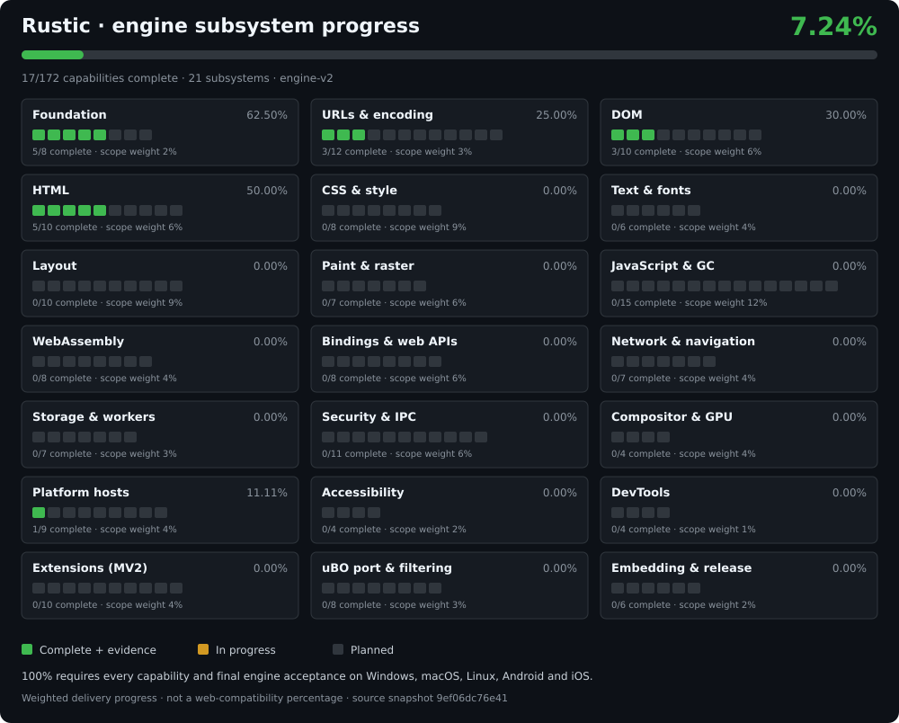

# Rustic

[](https://github.com/MoeJoe37/Rustic/actions/workflows/ci.yml)

Rustic is an independent browser engine being built from scratch in Rust. The
goal is a standards-oriented, embeddable engine with its own HTML/CSS pipeline,
DOM, layout, painting, JavaScript runtime, and web platform integration.

Rustic must run on **any device that can run a browser**. The release platforms
are **Windows, macOS, Linux, Android, and iOS/iPadOS** on every CPU they ship
on: x86-64, ARM64, 32-bit ARM and 32-bit x86, with RISC-V, big-endian and other
architectures kept working too. CI runs the full test suite natively on x64 and
ARM64 Linux, Windows and macOS, under emulation on 32-bit ARM, 32-bit x86,
RISC-V and big-endian s390x, and compile-checks Android, iOS and further targets.
Device shells, rendering, input, and runtime validation are still planned. See
[platform support](docs/PLATFORMS.md) and the [mobile plan](docs/MOBILE.md).

**Current stage: M3 static renderer.** The original pipeline covers local HTML,
computed CSS, block/inline/flex layout, OpenType text, image paint, CPU raster,
resize/zoom and hit testing. See the [implementation ledger](docs/IMPLEMENTATION.md)
for precise tested contracts. JavaScript execution, web-page networking and
native host acceptance remain later milestone work.

<!-- rustic-progress:start -->

## Engine progress

[](docs/progress/summary.md)

**Overall engine completion: 32.72%** (32.50% verified complete + 0.22% partial credit) — 53/172 capabilities complete and 1 in progress across 21 subsystems. Current milestone: **M4 ECMAScript runtime**, 0.00% done.

100% requires the full capability catalog and final engine acceptance on Windows, macOS, Linux, Android and iOS. This is weighted delivery progress; see [measurement and automatic updates](docs/PROGRESS.md).

<!-- rustic-progress:end -->

## Start here

| Document | Purpose |
| --- | --- |
| [Documentation index](docs/README.md) | Reading order and current implementation inventory |
| [Full-engine product requirements](docs/PRODUCT.md) | Brave-level security/privacy, broad site/CSS/JS compatibility, competitive targets, GPU and Wasm |
| [Rustic extensions and uBO port](docs/EXTENSIONS.md) | Rustic-only Manifest V2 ecosystem, blocking APIs and the planned uBlock Origin port |
| [Implementation progress](docs/IMPLEMENTATION.md) | Completed tasks, tested contracts, and the next implementation work |
| [Progress graph methodology](docs/PROGRESS.md) | Whole-engine completion criteria, weights, evidence and automatic commit updates |
| [URLs and origins](docs/URL.md) | Parser scope, identity rules, limits and pinned upstream test evidence |
| [CSS syntax](docs/CSS.md) | CSS tokenizer/parser scope, recovery, limits and pinned corpus evidence |
| [HTML input and tokenization](docs/HTML.md) | Streaming UTF-8 and initial tokenizer subset, limits, evidence and remaining states |
| [Platform and device support](docs/PLATFORMS.md) | Any device that can run a browser: portability rules and the CI target matrix |
| [Mobile support](docs/MOBILE.md) | Android/iOS architecture, compile checks and device milestones |
| [Architecture](docs/ARCHITECTURE.md) | Components, ownership, execution, IPC, embedding, and data flow |
| [Roadmap](docs/ROADMAP.md) | Dependency-ordered milestones, acceptance gates, first tasks, and risks |
| [Standards and compatibility](docs/STANDARDS.md) | Feature scope, authoritative references, and conformance reporting |
| [Security model](docs/SECURITY.md) | Trust boundaries, origin policy, isolation, and browsing gates |
| [Testing strategy](docs/TESTING.md) | Unit tests, conformance, rendering, fuzzing, and regression policy |
| [Performance plan](docs/PERFORMANCE.md) | Benchmarks, budgets, profiling, and optimization order |
| [Development and CI](docs/DEVELOPMENT.md) | Build instructions and exact automation coverage |
| [Dependencies and platforms](docs/DEPENDENCIES.md) | Meaning of “from scratch,” dependency policy, and platform rollout |
| [Architecture decisions](docs/adr/README.md) | Decisions, alternatives, and review triggers |

## Run the foundation

Install Rust through [rustup](https://rustup.rs/), then:

```sh
git clone https://github.com/MoeJoe37/Rustic.git
cd Rustic
cargo run --locked -p rustic-cli -- info
cargo test --locked --workspace --all-targets
cargo test --locked --workspace --doc
cargo run --locked -p rustic-dom --example tree
cargo run --locked -p rustic-url --example resolve
cargo run --locked -p rustic-html --example tokenize
cargo run --locked -p rustic-html --example text_modes
cargo run --locked -p rustic-html --example document
cargo run --locked -p rustic-cli -- dump-style crates/rustic-cli/tests/fixtures/styled.html
cargo run --locked -p rustic-cli -- dump-boxes crates/rustic-cli/tests/fixtures/boxes.html
cargo run --locked -p rustic-cli -- dump-formatting crates/rustic-cli/tests/fixtures/formatting.html
cargo run --locked -p rustic-cli -- dump-layout crates/rustic-cli/tests/fixtures/layout.html
```

The toolchain file pins Rust **1.99.1** for reproducible development. The minimum
supported Rust version is **1.85.0**, tested separately in CI; the workspace uses
the 2024 edition. The commands are `rustic info`, `--help`, `--version` and
`rustic dump-dom <file>`, which loads one local HTML file within byte, token,
node and output budgets and prints a deterministic DOM dump, and
`rustic dump-style <file>`, which prints each element's computed style for the
same file. `rustic dump-boxes <file>` exposes M3's initial principal-box
snapshot; `rustic dump-formatting <file>` shows anonymous flow boxes and inline
continuations before shaping. `rustic dump-layout <file>` adds [used block rectangles](docs/LAYOUT.md)
for a static block subset with adjoining-margin collapse. `rustic dump-paint <file>` prints
its [display list](docs/PAINT.md) and `rustic render --output out.png <file>` rasterizes
the full supported display list to a PNG on the CPU; `rustic reftest <test>`
compares a page's render with its `rel=match` references. Text uses OpenType shaping with Arabic/Indic and CSS wrapping/bidi policies;
local PNG/JPEG/GIF/WebP images paint. `--font FILE` loads granted local
TTF/OTF/WOFF/WOFF2 files for font metrics, shaping and paint. Without it, bundled
test fonts keep results deterministic. [Text contracts and limits](docs/TEXT.md)
include the remaining native font services and broader conformance work. URLs and other
arguments return an error instead of implying navigation.

The `tree` example builds nodes directly through the internal DOM API and prints
a deterministic inspection dump. It does not parse HTML or load a page.
The `tokenize` example reads a small UTF-8 stream in chunks and emits tokens;
comments, doctypes, processing instructions and named/numeric character references
are included. The `text_modes` example uses token-at-a-time feedback for
RCDATA/raw text/script/plaintext contexts. The `document` example parses a local
fixture into a DOM tree with implied elements and paragraph recovery. Unsupported
tree constructs return explicit errors; broad tree-building rules remain pending.

The current crates are `rustic-base` (identity, budgets, cancellation, source spans,
clocks and redacted diagnostics), `rustic-dom` (bounded node storage, checked tree mutation and
[UTF-16 text edits](docs/DOM.md)),
`rustic-url` (URL records, parsing and origins),
`rustic-html` (streaming tokens and full WHATWG document tree construction),
`rustic-css` (CSS syntax, selectors, specificity and typed property values),
`rustic-style` (selector matching, the cascade and computed style over a read-only DOM view),
`rustic-layout` (checked geometry, principal boxes and reference block widths),
`rustic-paint` (display lists), `rustic-raster` (CPU rasterizer and PNG output),
`rustic-codecs` (bounded inflate and PNG decoding),
`rustic-engine` (bounded viewport configuration), `rustic-cli`
(development entry point), and `rustic-fuzz` (deterministic parser fuzzing). Future crates listed in the architecture
are created only when their milestone needs them. All packages are unpublished.

## Development direction

The complete product targets security/privacy at least as strong as Brave, broad
standards-complete website/CSS/JavaScript support, and measured improvements over
Chrome and Firefox. GPU acceleration, WebAssembly, **Rustic-only Manifest V2
extensions**, and a rebuilt/ported **uBlock Origin for Rustic** are required parts
of the plan. These are future acceptance targets, not current support or measured
superiority. See [product requirements](docs/PRODUCT.md) for exact gates and scope.

1. Establish deterministic infrastructure and parser tests.
2. Render local static documents with an original HTML/CSS/layout pipeline.
3. Build the original JavaScript interpreter and connect it to DOM/event loops.
4. Add controlled networking, browser policy, storage, and platform integration.
5. Establish process isolation and security gates before general web browsing.
6. Expand modern platform compatibility, accessibility, performance, and embedding.

Rustic is not based on **Mozilla, Firefox, Gecko, or SpiderMonkey**. No Chromium,
Blink, WebKit, Servo, or existing JavaScript engine is embedded as its implementation.
That rule applies to desktop and mobile hosts alike. Reviewed low-level libraries
for TLS, fonts, Unicode, image codecs,
graphics APIs, and operating system integration are allowed. See
[dependency boundaries](docs/DEPENDENCIES.md) for the precise policy.

## Contributing and license

Read [CONTRIBUTING.md](CONTRIBUTING.md) before making a change. Security reports
follow [SECURITY.md](SECURITY.md). The existing [GNU Affero General Public License
version 3](LICENSE) is preserved; workspace metadata uses `AGPL-3.0-only`.
