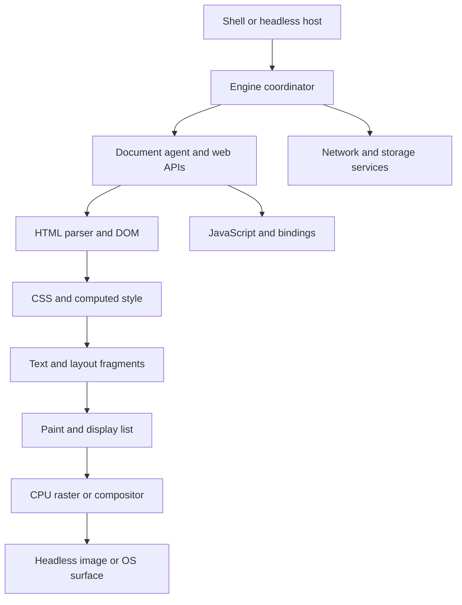

# Architecture

## 1. Mission and constraints

Build an original Rust implementation of the web engine, usable headlessly and
embedded in desktop and mobile browsers on Windows, macOS, Linux, Android, and
iOS/iPadOS. Mozilla/Firefox/Gecko, SpiderMonkey, Servo, Chromium/Blink and WebKit
are not implementation foundations. Standards behavior and diagnosability
come before optimization. A small vertical slice must be runnable before broad
feature expansion. Linux headless is the reference runtime; Windows and macOS
remain native compile/test targets. Android and iOS shared-library cross-checks
start during M1; platform host and device/runtime gates follow the [mobile plan](MOBILE.md).

An engine owns document interpretation and web execution. Browser chrome owns
tabs, address entry, profiles, permissions UI, downloads, and OS integration.
Keep those responsibilities separate so an embedder does not need the reference
shell. Browser chrome must never be controlled by page DOM or page CSS.

The implementation starts with local fixtures and no network. A single-process
development harness is permitted for trusted input; it is not a sandbox. Design
service interfaces early, then introduce enforced process isolation before
arbitrary remote content. Rust memory safety alone cannot enforce browser policy. That order
held: since M7 every document command runs its page in a confined renderer
child and its network exchanges in a confined network process, and remote
origins became grantable only after that (ADR 0066, 2026-11-22). The
single-process mode remains for trusted fixtures (`--single-process`).

## 2. Component map

The required product scope includes GPU/Wasm, a native MV2 extension ecosystem
and a Rustic uBlock Origin port, with comparative security/privacy and performance
gates. See [PRODUCT.md](PRODUCT.md) and [ADR 0007](adr/0007-product-scope.md).

The table describes the current [Cargo workspace](../Cargo.toml) and the
main boundary each crate owns. Specific behavior and tested limits are in the
[implementation ledger](IMPLEMENTATION.md).

| Crate | Responsibilities | Main boundary | First milestone |
| --- | --- | --- | --- |
| `rustic-base` | Typed IDs, checked geometry, byte budgets, cancellation, clocks, diagnostics | std, reviewed utility crates | M1 |
| `rustic-url` | WHATWG URL parsing/serialization, origin records, relative resolution, UTS #46 IDNA | base; generated Unicode IDNA/NFC tables | M1 |
| `rustic-encoding` | Encoding Standard labels, decoders and encoders for all 40 encodings, BOM sniffing and the decode/encode hooks ([ENCODING.md](ENCODING.md)) | none; indexes generated from pinned whatwg/encoding data | M6 entry (started during M5) |
| `rustic-html` | Encoding integration, incremental tokenizer, tree builder, recovery | base, DOM mutation interface, encoding | M1 |
| `rustic-dom` | Document/node graph, mutation, names, events, traversal, tracing integration | base, URL | M1 |
| `rustic-css` | Syntax tokens, stylesheet/declaration parsing, selectors, value syntax | base | M2 |
| `rustic-style` | Selector matching, cascade, inheritance, computed styles, invalidation, external sheet loading through an embedder fetcher | CSS, read-only DOM view, URL, text (font metrics, Bidi_Class) | M2 |
| `rustic-text` | Font selection, shaping adapter, bidi, line breaking, glyph metrics/cache | base, reviewed text/font libraries | M3 |
| `rustic-layout` | Formatting contexts, fragments, intrinsic sizes, hit-test geometry | base, computed styles, text | M3 |
| `rustic-paint` | Stacking/paint order, immutable display lists, clipping, damage | base, layout fragments | M3 |
| `rustic-raster` | Deterministic CPU display-list interpreter and surfaces | base, paint commands, codec adapters | M3 |
| `rustic-codecs` | Bounded from-scratch decoders: inflate, PNG, JPEG, GIF and WebP | base | M3 |
| `rustic-js` | Original ECMAScript lexer, parser, bytecode/interpreter, values, heap, built-ins | base; no DOM/network dependency | M4 |
| `rustic-wasm` | Original bounded Wasm decoding, validation, interpreter and instance state. Hosts link supported numeric functions and globals and unshared memories explicitly | base. `rustic-bindings` connects it to Window, JS tracing, Fetch and CSP. [ADR 0077](adr/0077-wasm-decoding-and-execution-boundaries.md) | M9 |
| `rustic-bindings` | Web IDL metadata, JS/DOM wrappers, conversions, selector queries and host tracing. Window hosts events, timing, Fetch, Web Storage, encodings, URLs, Blob and Wasm adapters | JS, DOM, style and explicit network, storage and Wasm interfaces | M5 onward |
| `rustic-net` | Origin allowlist, own HTTP/1.1 transport with limits, timeouts, cancellation and backpressure, TLS adapter, content codings, loopback fixture server (NET-01); navigation, redirects, MIME types, Referrer Policy (NET-02); Fetch modes, CORS, preflight cache and filtered responses (NET-03); cookie jar, sites and partitioned HTTP cache (NET-04, ADR 0054); CSP and mixed content (NET-05); process keys, COOP/COEP and ORB (ADR 0057); exchanges through a network-process connector (ADR 0061); remote addresses limited to public ranges (ADR 0066) | URL, base, encoding, codecs; rustls, ring, rustls-platform-verifier, brotli-decompressor (ADR 0051) | M6 |
| `rustic-storage` | Profiles (ephemeral, private, persistent with a lock), storage keys partitioned by top-level site, quotas, versioned checksummed atomic files with quarantine, Web Storage areas (NET-06); later IndexedDB and eviction | none (std only); callers supply origins and sites | M6/M9 |
| `rustic-ipc` | Versioned bounded broker/renderer channel and protocol over standard streams, hostile-peer decoding (ISO-02, ADR 0056) | none (std only) | M7 |
| `rustic-sandbox` | OS confinement for renderer, network and GPU processes through Linux, Windows and macOS adapters | OS-specific launch and policy. The [unsafe boundary](SECURITY.md#memory-resource-exhaustion-and-native-code) is limited to the Windows launcher and macOS Seatbelt entry | M7 onward |
| `rustic-android` | Android isolated-renderer service adapter and narrow JNI entry points for the emulator fixture | Windowless renderer host via `rustic-cli`, with detached descriptors and versioned IPC. [ADR 0059](adr/0059-mobile-renderer-isolation.md) | M7 |
| `rustic-a11y` | Semantic accessibility tree, names, states, focus and mapped geometry | Browser DOM and layout snapshots. `rustic-shell` implements the AccessKit platform bridges | M8 |
| `rustic-devtools` | Inspection, console, debugger, performance and automation protocol state | Engine data and a brokered stdio transport hosted by the CLI. [ADR 0072](adr/0072-automation-protocol.md) | M8 |
| `rustic-engine` | Host-facing document lifecycle, script turns, resource publication and rendering coordination | HTML, JS, DOM bindings and engine components. Host I/O and native windows stay outside | M0 onward |
| `rustic-cli` | Development commands, browser broker, renderer/network/GPU entry points and desktop reference chrome | Connects shared engine code to the sandbox, shell and services. Also provides the renderer host library | M0 onward |
| `rustic-renderer` | Windowless subprocess executable for platforms that need a separate renderer binary | CLI renderer code with the desktop window feature disabled | M8 |
| `rustic-shell` | Desktop windows, surfaces, event loop, input/IME and platform accessibility transport | winit, softbuffer and AccessKit. The CLI owns tabs and browser policy. [ADR 0074](adr/0074-browser-shell-and-native-hosts.md) | M8 |
| `rustic-gpu` | GPU compositing, surface and device recovery, and CPU-compatible reference arithmetic | Reviewed wgpu adapter inside the GPU process, over scenes and pixel buffers. [ADR 0071](adr/0071-gpu-backend.md) | M8 |
| `rustic-native` | Native font discovery through DirectWrite and Core Text | Narrow OS font-service adapters. The broker validates the files it opens. [ADR 0078](adr/0078-platform-font-services.md) | M8 |
| `rustic-fuzz` | Deterministic mutation harness, corpora, replay and minimized artifacts | Public and test interfaces of parsers, JS, Wasm, rendering, network and IPC | M1 onward |

Workers, extensions and the filter engine still need their reviewed service
interfaces. [EXTENSIONS.md](EXTENSIONS.md) records the planned authority and
package boundaries. Native mobile surfaces, input and lifecycle integration
are scheduled for [M14](MOBILE.md).

Dependencies form a DAG. Keep the pure tokenizer, selector parser, and JavaScript
runtime usable independently. DOM exposes mutation and read views without
depending on style/layout. Style invalidation consumes mutation records; it does
not call back into arbitrary JavaScript. Layout produces geometry; rasterization
does not read or mutate live DOM. Engine orchestration resolves integration,
instead of a global mutable singleton shared across crates.

Arrows show major data/control flow, not every Cargo dependency. In particular,
JS interacts with DOM through bindings and service access goes through policy.

The headless host admits a bounded number of documents through `rustic-engine`.
An admitted load owns the parser, then transfers the completed tree to a document
owner. The engine weakly tracks a cancellation scope for each owner. Shutdown
closes admission and signals all scopes, while dropping an individual owner
signals only its own work. Host adapters participate by passing the document's
token through parsing, resource reads and rendering. See [ADR 0020](adr/0020-document-lifecycle.md).

## 3. Documents, identity, and memory

Use typed `DocumentId`, `NodeId`, `NavigationId`, `FrameId`, `ResourceId`, and
`FrameEpoch`, with separate ID domains. An arena ID contains a slot and generation;
lookups check generation and document ownership. Never serialize Rust pointers,
references, or raw arena indexes across processes. Node identity survives DOM
mutation, but references to destroyed documents fail validation.

Initially a document owns a nonmoving node arena. Public node handles do not
expose `Rc<RefCell<_>>` or borrow lifetimes tied to the whole engine. Before JS
bindings land, implement a nonmoving traced heap with explicit root scopes,
generation-checked handles, and a shared tracing contract for JS and DOM objects.
The runtime heap can trace registered host objects without depending on the DOM
crate. Document roots, active jobs, stacks, bindings, and embedder handles are
roots. A detached subtree stays alive if reachable from JS; unreachable cycles
across JS objects, DOM nodes, event listeners, and closures must be collectable.

Start with stop-the-world mark/sweep on the document agent thread. Incremental or
generational collection needs a later ADR, barriers, and correctness tests. A weak
wrapper cache preserves identity without retaining dead nodes. One binding
coordinator per agent records wrappers by node and realm. The joint trace
includes every registered document, and cross-document adoption retargets
all wrappers through the DOM identity map.
[ADR 0026](adr/0026-realm-dom-wrappers.md)

A scripted document shares its parsed tree between the renderer and the
agent's binding host. The VM asks that host to collect at script and
promise-job safe points. Binding operations borrow the tree briefly and
release it before any script callback. Node factories and text operations
also finish argument coercion before mutating the DOM.
[ADR 0028](adr/0028-scripted-document-collection.md),
[ADR 0029](adr/0029-scripted-node-creation.md)

Selector queries borrow the live document after JavaScript string coercion
and meter native traversal against the current script turn. A static
NodeList traces its node wrappers. A live child list and its source node
trace each other, so the joint collector can reclaim an unreachable cycle.
Direct `children` HTMLCollections share that ownership model. A filtered
descendant collection traces its source and filter through private JS data.
One page-local positional index shares the current root's child and
element-child IDs, versioned by document child links. Collection membership
and names are read from the current tree. Named-property visibility can
call Proxy traps after releasing DOM borrows.
[ADR 0030](adr/0030-dom-selectors-and-node-lists.md),
[ADR 0031](adr/0031-live-html-collections.md)

A scripted page retains one ordinary Window as the realm's global object and
a distinct WindowProxy as its global this binding. Global name resolution
and property storage retain the same realm and DOM. Script accessors receive
the proxy when invoked through a global identifier. Both objects are traced
through the realm's global environment. Standalone agents keep their ordinary
global object as global this.
[ADR 0032](adr/0032-top-level-window-realm.md)

Detached documents share the page's wrapper coordinator. A reachable
node or DOMImplementation marks its owning document and connected tree.
The active tree remains rooted through the page, and an unreachable
detached document is removed from the registry as a unit. Cross-document
insertion stages target nodes, checks the destination, and then commits
the source removal and wrapper retargeting. Direct-child collection caches
use wrapper identity so they follow an adopted node's new arena IDs.
[ADR 0033](adr/0033-detached-documents-and-adoption.md)

EventTarget listeners and Event state live in the agent's traced heap.
The page roots private weak maps keyed by target and event wrapper identity,
so connected targets keep their callbacks and adoption leaves registration
identity intact. A dispatch holds its frozen path across callbacks. Each
phase snapshots matching listener records, then releases native DOM borrows
before running script. Trust is private event state set by native delivery.
A separate weak map keyed by HTML input wrappers stores checkbox state.
[ADR 0034](adr/0034-dom-event-dispatch.md),
[ADR 0035](adr/0035-trusted-input-and-activation.md)

Document script realms install `DOMException` through `rustic-bindings`.
The JS heap owns the exception's private strings and the installed
interface's realm prototype. Engine error conversion uses that prototype
even when script has replaced the global constructor.
[ADR 0027](adr/0027-host-exception-bindings.md)

Generation IDs
detect stale references; they do not replace reachability tracking. Style/layout
data live in separate epoch-owned arenas and use weak node identity. Explicitly
dispose native resources; collection is not a timely file/network close protocol.

Use Rust UTF-8 for tooling and byte-oriented source buffers where appropriate.
ECMAScript strings use UTF-16 code units, including lone surrogates. DOM string
conversion follows its IDL type; do not silently normalize or replace code units.
Distinguish source byte offsets, UTF-16 offsets, scalar indices, and glyph clusters.
The current [character-data storage contract](DOM.md) validates range edits and
reserves capacity through the owning document before changing payload/accounting.
It supplies parser text appends; web-facing observers and live ranges remain pending.

Each untrusted entry point consumes a resource budget: input bytes, tokens,
nodes, nested structures, decoded pixels, heap, tasks, and wall/CPU time. Bound
queues and caches. Checked arithmetic precedes allocation. Avoid recursion whose
depth comes directly from content. A future surface allocation must validate
stride and bytes per pixel as well as the viewport pixel count present at M0.

## 4. Parsing, style, layout, and painting

The `rustic-html` crate depends on `rustic-base`, `rustic-dom` and `rustic-encoding`.
It implements incremental decoded input, data/tags, named/numeric references, comments, doctypes,
processing instructions and caller-controlled RCDATA/RAWTEXT/script/plaintext
states. Syntax families have focused internal modules. The pull
driver owns queued input and pauses at token boundaries for mode feedback; it
does not infer tree-builder context from tag names. See [ADR 0008](adr/0008-tokenizer-drive.md).
The inert document parser owns a checked DOM while driving an explicit subset of
initial/head/body insertion modes. Failed partial trees are discarded; only EOF
transfers ownership. [ADR 0009](adr/0009-parser-owned-construction.md) records the
construction boundary and [HTML tree scope](HTML_TREE.md) lists accepted/rejected
constructs. See [HTML.md](HTML.md) for tokenization.

An opt-in scripted load borrows the parser's live DOM through the page host
between tokens. The engine ends its mutable parser borrow before running a
classic or its promise jobs. Joint collection traces parser-held identities
and the current script alongside ordinary DOM and JavaScript roots. EOF
publishes the same document and agent to the turn pump once local sources
settle. The engine resolves in-grant external script URLs with `rustic-url`.
The embedder owns file access and delivers each result against a request ID.
The engine sequences the parser and scripts around those completions.
Local JavaScript modules share parsed records, namespace objects and
completion promises within the page realm. The same after-EOF queue orders
modules and deferred classics. The engine owns document readiness transitions
and publishes only after document and script lifecycle events are delivered.
[ADR 0037](adr/0037-parser-script-boundary.md), [ADR 0038](adr/0038-parser-inserted-inline-classics.md)
[ADR 0039](adr/0039-local-external-classics.md), [ADR 0040](adr/0040-local-module-scripts.md)
and [ADR 0041](adr/0041-scripted-document-readiness.md).

The following broader pipeline describes the target architecture.

The loader produces byte chunks plus response metadata. Encoding detection and
decoder state precede HTML tokenization; charset changes may require a bounded
restart before the appropriate lock point. The tokenizer preserves state across
chunks and feeds a tree builder with insertion modes, implied elements, foster
parenting, formatting-element reconstruction, templates, and quirks mode. Parse
errors usually recover per HTML rather than aborting. DOM mutation is observable;
parser-blocking scripts suspend/resume the parser and later support reentry.

CSS syntax parsing is separate from property validation. Unknown declarations
are discarded according to grammar recovery rather than accepted as arbitrary
strings. The cascade models origins, importance, order, specificity, inheritance,
initial values, and later layers/custom properties. Keep specified, computed,
used, and actual values distinct. A UA stylesheet provides defaults. Mutation,
stylesheet, pseudo-class, viewport, and font changes produce invalidation sets.
Start with a correct full restyle/reflow before selective invalidation.

Layout consumes a stable style snapshot. REN-01a starts this boundary in
`rustic-layout` with checked unit geometry, principal snapshots and block width
measurement; REN-01b/REN-02a emit used static-block geometry and collapsed
margins through bounded top-down/bottom-up/top-down passes without live DOM
access. REN-01c derives a borrowed formatting forest from the principal snapshot,
wrapping mixed inline runs and splitting inline ancestors around block groups.
Source indexes and continuation edges preserve identity without DOM reparenting.
Anonymous styles inherit from their enclosing non-anonymous source and reset
non-inherited values. Separate box/depth/work limits bound expansion; both trees
use flat arenas. See [LAYOUT.md](LAYOUT.md). The [layout guide](LAYOUT.md) records the later inline, float, positioning
and flexbox work, along with the remaining formatting contexts. REN-04a/REN-05a add
`rustic-paint` (display lists in paint order) and `rustic-raster` (exact-area CPU
fills and PNG); see [PAINT.md](PAINT.md). Generate a box tree distinct from DOM,
then fragments for block/inline formatting, anonymous boxes, line boxes, replaced
elements, and later fragmentation. Distinguish CSS pixels, device pixels, logical
inline/block axes, and font units in types. Resolve containing blocks, intrinsic
sizes, margin collapse, overflow, baseline alignment, and rounding deliberately.
Use deterministic bundled fonts for reference tests, then system discovery for UI.
Arabic shaping, combining marks, bidi, grapheme navigation, and fallback are
explicit text work; a character-to-glyph mapping is only an early debug aid.

Painting builds an immutable, versioned display list: rectangles, borders, glyph
runs, images, clips, transforms, and stacking contexts. Hit testing shares fragment
geometry and transforms with painting. The CPU rasterizer is the initial reference
backend; GPU scenes/raster acceleration are a required production backend, with
a usable CPU fallback and independent parity tests. Frame epochs
prevent an old layout or resource completion from replacing a newer frame. The viewport scene can reuse cached tiles during scroll updates when geometry
permits ([ADR 0064](adr/0064-scrolling-and-compositor-scenes.md)).

## 5. JavaScript and host execution

Build Rustic's own runtime, beginning with an interpreter. The lexer and parser
(JS-01, [JS.md](JS.md)) handle lexical goals, automatic semicolon insertion,
source spans, early errors, strict mode, scopes, and Unicode identifiers.
Execution compiles the AST to compact register bytecode and drops the AST; there
is no long-lived tree-walking evaluator, because it would double the memory per
function and run slower. Values are 8 bytes, heap objects live in `u32`-indexed
typed arenas charged to the agent budget, objects share shapes with inline
caches, and JS calls do not recurse on the Rust stack. The
[M4 memory and performance design](ROADMAP.md#memory-and-performance-design)
lists these commitments and ADR 0015 records the exact layout. Preserve
completion records, references, environments, property descriptors, prototypes,
call/construct semantics, exceptions, realms, and abstract operations. Do not
substitute Rust numeric/string behavior for ECMAScript coercions.

Stage built-ins, functions/closures, collections, promises, modules, typed arrays,
BigInt, RegExp, proxies, and Intl against explicit Test262 selections. The VM has
no filesystem, sockets, process spawning, or implicit native API. Host callbacks
receive explicit capabilities. Instruction checkpoints support cancellation and
budgets; an infinite script must not freeze browser chrome. JIT compilation is
deferred until compatibility and profiling justify its security and maintenance
cost. WebAssembly is a required separate original runtime with bounded decoding,
validation, execution/traps and explicit imports. Its JS identity/tracing and Web
compilation adapters follow the existing Fetch and document CSP policies.
Window module objects own byte snapshots and reflection metadata. Numeric
function, global and memory exports trace the interpreter state through the
JS heap. Global wrappers and importing instances share cells for scalar and nullable reference values.
An attached Wasm buffer views the current generation of linear memory and
traces its allocation owner. Resizable generations retain their wrapper on
growth. Mode changes move the bytes into a new generation and detach the old
one. Each memory has an address width and shares the byte budget of its
allocating owner. Local tables also carry their declared address width and
share an instance-wide entry budget with passive element segments. Standalone
Window tables initially keep reference entries in a private array traced through
the wrapper's ephemeron. On its first Wasm link, a standalone table moves its
entries to a shared interpreter allocation with a heap reservation for bounded
growth. Imports retain their source wrappers and the allocation remains on
its owner's budget. Re-exports return those same wrappers.

A function address contains its defining instance's host identity and function
index. The instance caches function wrappers and the collector follows
external references and function owners reachable from guest state. The host
attaches code and import records to the rooted instance before applying active
segments. A completed write into a shared table can keep the defining instance
alive after an initialization trap. For dispatched imports and cross-instance
indirect calls, guest store borrows are released and suspended frames' references
are rooted for the call. The tracing interface carries typed numeric and
nullable reference arguments and results. The interpreter checks full-width table indices before
converting them to host indices. The realm propagates JavaScript exceptions,
and the interpreter remains available without executable-memory permission.
[ADR 0080](adr/0080-window-wasm-module-compilation.md),
[ADR 0081](adr/0081-owned-wasm-instances.md), [ADR 0082](adr/0082-wasm-numeric-globals.md),
[ADR 0083](adr/0083-wasm-js-function-imports.md), [ADR 0084](adr/0084-shared-numeric-wasm-globals.md),
[ADR 0085](adr/0085-wasm-fixed-memory-buffers.md), [ADR 0086](adr/0086-wasm-memory64.md),
[ADR 0087](adr/0087-wasm-resizable-buffers.md), [ADR 0088](adr/0088-window-wasm-tables.md),
[ADR 0089](adr/0089-live-wasm-function-tables.md), [ADR 0090](adr/0090-live-wasm-external-tables.md), [ADR 0091](adr/0091-wasm-external-table-imports.md), [ADR 0092](adr/0092-wasm-function-table-imports.md), [ADR 0093](adr/0093-wasm-reference-interop.md)

Filtered Wasm responses can pass a private body reader to the Window binding.
The renderer pulls chunks by a broker-scoped handle or directly in
single-process mode. A bounded section decoder runs in the renderer and
keeps reflection bytes until the module is validated. The broker retains
request authority and normal transport backpressure.
[ADR 0094](adr/0094-wasm-progressive-response-decoding.md)

The extension design assigns execution under distinct principals/realms through broker-checked
capabilities, with isolated content-script worlds and attributed messages. Native
MV2 blocking callbacks and trusted compiled filters share a deterministic request
policy pipeline; neither grants cross-origin or native authority. The planned uBO port
is a separately licensed application using these APIs. See [EXTENSIONS.md](EXTENSIONS.md)
for package/permission, lifecycle, filter-data and update boundaries.

Static module loading takes explicit host callbacks for request resolution and
source provision. The frontend validates the dependency graph and binding
targets before evaluation. The host owns module identity, import attribute
policy and any I/O. Evaluating a static graph creates one traced environment
and namespace per module and runs dependencies in request order. Import slots
hold direct references to the defining environment and binding, or to a
namespace. See [static module loading](JS.md#static-module-loading-js-06).

A document agent owns DOM mutation and JavaScript execution on one thread.
Rust async tasks may perform I/O off-thread; they post completions to the owning
agent, never execute page callbacks directly. The coordinator schedules task
sources, microtask checkpoints, rendering opportunities, timers, animation frames,
and user input according to the HTML model. ECMAScript jobs and host tasks are
distinct. No Rust lock or DOM mutable borrow is held across a call into page JS.
Event dispatch, custom callbacks, and getters are reentry points. Define safe
points and root scopes before implementing them.

The Web IDL conversion layer roots each object it coerces and propagates
ECMAScript exceptions through the agent. Binding callers complete
coercion before borrowing the DOM for mutation. Pinned IDL declarations
generate the text interface metadata consumed by these conversion paths.
[ADR 0024](adr/0024-web-idl-conversions.md),
[ADR 0025](adr/0025-pinned-dom-idl-metadata.md)

The headless coordinator now offers an explicit scripted document owner.
It runs immediate scripts, timers and host-selected input with bounded
microtask checkpoints and one cancellation scope. Input uses the immediate
FIFO. Pointer hit testing and keyboard targeting belong to the host, and the
coordinator validates the supplied node when it queues and delivers the input.
Window timers use the deadline heap shared with host timers. Window timer and
frame callbacks keep their JavaScript values in the agent's host roots
while pending. The renderer-aware pump runs frame callbacks and their
checkpoints before the renderer, then gives the host document-scoped tickets
to validate before presentation. The host clock supplies timer eligibility
and rendering opportunity timestamps.
[ADR 0021](adr/0021-document-script-turns.md),
[ADR 0022](adr/0022-document-task-sources-and-timers.md),
[ADR 0023](adr/0023-document-rendering-turns.md),
[ADR 0035](adr/0035-trusted-input-and-activation.md),
[ADR 0036](adr/0036-window-timers-and-animation-callbacks.md)

## 6. Navigation, resources, and persistence

The coordinator owns a navigation state machine: requested, policy-checked,
fetching, provisional document, committed, complete/failed/cancelled. Same-document
navigation takes a separate path. Assign the origin from committed navigation
rules, not a renderer-supplied string. Recheck redirects, MIME, policy containers,
and resource limits at every relevant step. A newer navigation cancels previous
work; all asynchronous completions carry the navigation/document epoch.

Network request context includes initiator origin, top-level site, destination,
credentials mode, referrer policy, CSP context, and cancellation. A reviewed HTTP
transport is not the Fetch implementation: Rustic owns CORS, response filtering,
redirect semantics, cookie access, mixed-content and other browser policy.
Classify trust at service ingress; validate a request even if the renderer says it
already checked it. Partition cache/cookies/storage consistently and invalidate
authority after navigation. Dev fixture transport is explicit and unavailable to
normal page script.

Storage keys include origin and the selected top-level partition policy. Start
with ephemeral in-memory profiles, then versioned disk schemas and atomic updates.
Private mode avoids persistent writes and clears state on exit. IndexedDB and
service-worker storage require their own transactions/lifecycle work later. A
profile lock prevents unsafe concurrent writers. Database failures degrade to a
documented error; never reinterpret corrupted persisted state as trusted config.

## 7. Processes, IPC, and crash recovery

The reference host separates the browser broker, page renderers, network
process and GPU process. Storage stays brokered. Site/agent policy determines
renderer ownership. Do not promise a
literal process-per-tab or process-per-origin mapping: cross-origin frames,
same-origin synchronous access, opener relationships, and agent clusters require
an isolation policy designed together. M7 defines the mapping and tests
(ADR 0057). Frames render in renderers of their own and the broker
composites them, so an embedder never holds a frame's bytes or pixels
(ADR 0062); same-site frame agent-cluster sharing remains open (TD-178).

Renderers receive narrow handles instead of ambient OS privileges. Linux uses
namespace/seccomp/broker controls (bubblewrap, ADR 0058); Windows a
capability-less LPAC AppContainer and a job (ADR 0060); macOS a deny-by-default Seatbelt profile the renderer applies to itself with `sandbox_init` before reading input (ADR 0063, verified on native Macs).
The Android emulator runs a prototype isolated renderer service. Android
device acceptance and the iOS browser-engine entitlement and runtime
isolation are M14 work. Do not
assume desktop process spawning, Linux sandbox controls, or JIT availability can
be carried across unchanged. Platform adapters map the same authority contracts
to each OS; [ADR 0006](adr/0006-desktop-and-mobile-platforms.md) records this scope.
If a required sandbox cannot be enforced, general remote browsing remains gated
on that platform. Unsupported configurations must not silently weaken isolation.

IPC messages have protocol version, sender identity, document/navigation IDs,
sequence/epoch, bounded payload lengths, and typed variants. Validate limits before
allocation/deserialization; reject unknown capabilities, stale epochs, duplicate
replies, invalid handles, and version mismatches. Bound shared-memory size and
validate its layout; immutable snapshots avoid races with mutable renderer data.
No arbitrary-path open, raw pointer, or generic “execute host function” message.
Service death cancels outstanding operations. Renderer death produces a tab error
and releases handles without killing chrome. Recovery never reuses old authority.

## 8. Embedding, accessibility, and observability

The future Rust facade offers engine/profile creation, view creation, navigation,
resize, input, polling/event delivery, cancellation, and shutdown. Commands return
request IDs; events include navigation status, title, surface readiness, console,
permission requests, and failures. Callbacks are delivered at documented pump
points, not while internal borrows are held. An embedder grants capabilities for
network/files/clipboard/downloads explicitly. A C ABI is deferred until this Rust
API settles and must define ownership and ABI versioning.

Headless tests inject clocks, randomness, fonts, network fixtures, storage, and
surfaces. Production uses real implementations. Diagnostic events include stage,
duration, document and navigation IDs; redact credentials and private content.
DevTools binds to local authenticated opt-in transport. Accessibility consumes a
semantic DOM snapshot with roles, names, states, focus, and geometry, independently
of the display list; platform adapters map it to OS accessibility APIs.

## 9. Extension rules and review triggers

Keep APIs internal and unpublished through the prototypes. Do not create a
plugin ABI, distributed service architecture, or a global web-feature trait per
property. Add a crate only for a real ownership, testability, or dependency
boundary. Any change to original-engine scope, GC, process authority, JS host
capabilities, public API stability, or graphics backend requires an
[architecture decision](adr/README.md), regression tests, and roadmap updates.

## Text adapter boundary

Rustic owns font selection, source indexes, Unicode 17 segmentation/bidi, CSS
line policies, layout and paint. The reviewed HarfRust/Skrifa/Wuff adapter gets
immutable bounded font data and returns glyphs/outlines, without I/O authority.
Discovery is a separate explicit host grant. Sharing bytes and lazy caches does
not make those caches a global memory budget; TD-85 records the next accounting
work. Source-aware shaping and break policies remain Rustic responsibilities
(TD-86/87). See [ADR 0014](adr/0014-reviewed-font-adapters.md).
