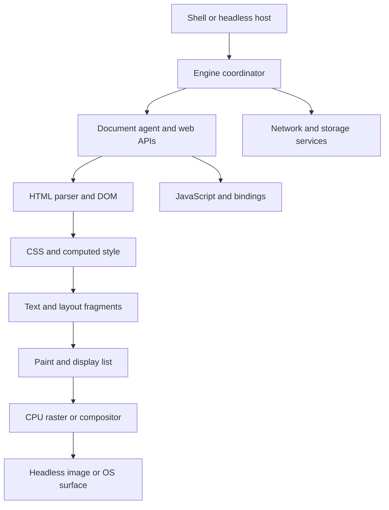

# Architecture

## 1. Mission and constraints

Build an original Rust implementation of the web engine, usable headlessly and
embedded in desktop and mobile browsers on Windows, macOS, Linux, Android, and
iOS/iPadOS. Mozilla/Firefox/Gecko, SpiderMonkey, Servo, Chromium/Blink and WebKit
are not implementation foundations. Standards behavior and diagnosability
come before optimization. A small vertical slice must be runnable before broad
feature expansion. Linux headless is the reference runtime; Windows and macOS
remain native compile/test targets. Android and iOS shared-library cross-checks
start during M1; platform host and device/runtime gates follow the [mobile plan](MOBILE.md).

An engine owns document interpretation and web execution. Browser chrome owns
tabs, address entry, profiles, permissions UI, downloads, and OS integration.
Keep those responsibilities separate so an embedder does not need the reference
shell. Browser chrome must never be controlled by page DOM or page CSS.

The implementation starts with local fixtures and no network. A single-process
development harness is permitted for trusted input; it is not a sandbox. Design
service interfaces early, then introduce enforced process isolation before
arbitrary remote content. Rust memory safety alone cannot enforce browser policy.

## 2. Component map

The required product scope includes GPU/Wasm, a native MV2 extension ecosystem
and a Rustic uBlock Origin port, with comparative security/privacy and performance
gates. See [PRODUCT.md](PRODUCT.md) and [ADR 0007](adr/0007-product-scope.md).

`rustic-base`, `rustic-dom`, `rustic-url`, `rustic-html`, `rustic-css`, `rustic-style`, `rustic-layout`, `rustic-text`, `rustic-paint`, `rustic-raster`, `rustic-engine`, `rustic-cli` and the
`rustic-fuzz` development tool now exist; see
[implementation progress](IMPLEMENTATION.md) for their actual scope. The following
is the target decomposition, not a requirement to create empty crates today.

| Proposed crate | Responsibilities | Primary dependencies | First milestone |
| --- | --- | --- | --- |
| `rustic-base` | Typed IDs, checked geometry, byte budgets, cancellation, clocks, diagnostics | std, reviewed utility crates | M1 |
| `rustic-url` | WHATWG URL parsing/serialization, origin records, relative resolution, UTS #46 IDNA | base; generated Unicode IDNA/NFC tables | M1 |
| `rustic-html` | Encoding integration, incremental tokenizer, tree builder, recovery | base, DOM mutation interface | M1 |
| `rustic-dom` | Document/node graph, mutation, names, events, traversal, tracing integration | base, URL | M1 |
| `rustic-css` | Syntax tokens, stylesheet/declaration parsing, selectors, value syntax | base | M2 |
| `rustic-style` | Selector matching, cascade, inheritance, computed styles, invalidation, external sheet loading through an embedder fetcher | CSS, read-only DOM view, URL (also Bidi_Class data, TD-29) | M2 |
| `rustic-text` | Font selection, shaping adapter, bidi, line breaking, glyph metrics/cache | base, reviewed text/font libraries | M3 |
| `rustic-layout` | Formatting contexts, fragments, intrinsic sizes, hit-test geometry | base, computed styles, text | M3 |
| `rustic-paint` | Stacking/paint order, immutable display lists, clipping, damage | base, layout fragments | M3 |
| `rustic-raster` | Deterministic CPU display-list interpreter and surfaces | base, paint commands, codec adapters | M3 |
| `rustic-codecs` | Bounded from-scratch decoders (inflate, PNG; later JPEG/GIF/WebP) | base | M3 |
| `rustic-js` | Original ECMAScript lexer, parser, bytecode/interpreter, values, heap, built-ins | base; no DOM/network dependency | M4 |
| `rustic-wasm` | Original bounded Wasm decoder, validator, interpreter and reviewed acceleration | base; JS/Web integration through explicit adapters | M4 foundations, M5/M9 integration |
| `rustic-bindings` | Web IDL subset tooling, JS/DOM wrappers, exception conversion, tracing edges | JS, DOM; generated from pinned IDL | M5 |
| `rustic-web` | Window, agents, tasks/microtasks, timers, script loading, browser APIs | JS, bindings, DOM, service interfaces | M5 |
| `rustic-net` | Fetch policy, HTTP adapter, redirects, cookies, cache, TLS integration | URL, base, audited protocol libraries | M6 |
| `rustic-storage` | Partitioned profile data, quotas, transactions, eviction/private mode | base, origin/storage keys, database adapter | M6/M9 |
| `rustic-extensions` | Rustic MV2 package/identity, isolated worlds, APIs, lifecycle and permissions | JS/web, broker/service interfaces; no ambient page authority | M5/M6 prototypes, M8/M9 delivery |
| `rustic-filter` | Bounded reference/optimized filtering, list snapshots and broker policy hooks | URL/base, controlled DOM/CSS interfaces | M6–M9 |
| `rustic-ipc` | Versioned messages, validation, resource handles, bounded transport | base, selected serialization adapter | M7 |
| `rustic-platform` | Windows/events, font discovery, graphics surfaces, OS adapters | base, platform libraries | M8 |
| Future Android/iOS adapters | Native surfaces, lifecycle, touch/IME, accessibility and OS service/process bridges | engine/platform contracts; JNI/NDK or Apple SDK only at the boundary | Prototype with M3; host integration M8 |
| `rustic-compositor` | Scene updates, scrolling/transforms, GPU submission and fallback | paint, platform, graphics adapter | M8 |
| `rustic-a11y` | Semantic accessibility tree and platform bridge | DOM semantic snapshot, layout, platform | M8 |
| `rustic-devtools` | Inspection protocol, logs, breakpoints, performance inspection | versioned engine debug interface | M8 |
| `rustic-engine` | Public Rust facade and browser/document lifecycle coordination | component/service interfaces | M0 onward |
| `rustic-cli` / future `rustic-shell` | Headless test host / desktop browser chrome | engine API, platform | M0 / M8 |
| `rustic-test-support` / `xtask` | Fixtures, fake services, corpus runners, dev commands | public/test interfaces | M1 onward |

Dependencies form a DAG. Keep the pure tokenizer, selector parser, and JavaScript
runtime usable independently. DOM exposes mutation and read views without
depending on style/layout. Style invalidation consumes mutation records; it does
not call back into arbitrary JavaScript. Layout produces geometry; rasterization
does not read or mutate live DOM. Engine orchestration resolves integration,
instead of a global mutable singleton shared across crates.

Arrows show major data/control flow, not every Cargo dependency. In particular,
JS interacts with DOM through bindings and service access goes through policy.

## 3. Documents, identity, and memory

Use typed `DocumentId`, `NodeId`, `NavigationId`, `FrameId`, `ResourceId`, and
`FrameEpoch`, with separate ID domains. An arena ID contains a slot and generation;
lookups check generation and document ownership. Never serialize Rust pointers,
references, or raw arena indexes across processes. Node identity survives DOM
mutation, but references to destroyed documents fail validation.

Initially a document owns a nonmoving node arena. Public node handles do not
expose `Rc<RefCell<_>>` or borrow lifetimes tied to the whole engine. Before JS
bindings land, implement a nonmoving traced heap with explicit root scopes,
generation-checked handles, and a shared tracing contract for JS and DOM objects.
The runtime heap can trace registered host objects without depending on the DOM
crate. Document roots, active jobs, stacks, bindings, and embedder handles are
roots. A detached subtree stays alive if reachable from JS; unreachable cycles
across JS objects, DOM nodes, event listeners, and closures must be collectable.

Start with stop-the-world mark/sweep on the document agent thread. Incremental or
generational collection needs a later ADR, barriers, and correctness tests. A weak
wrapper cache preserves identity without retaining dead nodes. Generation IDs
detect stale references; they do not replace reachability tracking. Style/layout
data live in separate epoch-owned arenas and use weak node identity. Explicitly
dispose native resources; collection is not a timely file/network close protocol.

Use Rust UTF-8 for tooling and byte-oriented source buffers where appropriate.
ECMAScript strings use UTF-16 code units, including lone surrogates. DOM string
conversion follows its IDL type; do not silently normalize or replace code units.
Distinguish source byte offsets, UTF-16 offsets, scalar indices, and glyph clusters.
The current [character-data storage contract](DOM.md) validates range edits and
reserves capacity through the owning document before changing payload/accounting.
It supplies parser text appends; web-facing observers and live ranges remain pending.

Each untrusted entry point consumes a resource budget: input bytes, tokens,
nodes, nested structures, decoded pixels, heap, tasks, and wall/CPU time. Bound
queues and caches. Checked arithmetic precedes allocation. Avoid recursion whose
depth comes directly from content. A future surface allocation must validate
stride and bytes per pixel as well as the viewport pixel count present at M0.

## 4. Parsing, style, layout, and painting

The current `rustic-html` crate depends on `rustic-base` and `rustic-dom`. It implements
explicit UTF-8 input, data/tags, named/numeric references, comments, doctypes,
processing instructions and caller-controlled RCDATA/RAWTEXT/script/plaintext
states. Syntax families have focused internal modules. The pull
driver owns queued input and pauses at token boundaries for mode feedback; it
does not infer tree-builder context from tag names. See [ADR 0008](adr/0008-tokenizer-drive.md).
The inert document parser owns a checked DOM while driving an explicit subset of
initial/head/body insertion modes. Failed partial trees are discarded; only EOF
transfers ownership. [ADR 0009](adr/0009-parser-owned-construction.md) records the
construction boundary and [HTML tree scope](HTML_TREE.md) lists accepted/rejected
constructs. See [HTML.md](HTML.md) for tokenization. The following broader pipeline
describes the target architecture.

The loader produces byte chunks plus response metadata. Encoding detection and
decoder state precede HTML tokenization; charset changes may require a bounded
restart before the appropriate lock point. The tokenizer preserves state across
chunks and feeds a tree builder with insertion modes, implied elements, foster
parenting, formatting-element reconstruction, templates, and quirks mode. Parse
errors usually recover per HTML rather than aborting. DOM mutation is observable;
parser-blocking scripts suspend/resume the parser and later support reentry.

CSS syntax parsing is separate from property validation. Unknown declarations
are discarded according to grammar recovery rather than accepted as arbitrary
strings. The cascade models origins, importance, order, specificity, inheritance,
initial values, and later layers/custom properties. Keep specified, computed,
used, and actual values distinct. A UA stylesheet provides defaults. Mutation,
stylesheet, pseudo-class, viewport, and font changes produce invalidation sets.
Start with a correct full restyle/reflow before selective invalidation.

Layout consumes a stable style snapshot. REN-01a starts this boundary in
`rustic-layout` with checked unit geometry, principal snapshots and block width
measurement; REN-01b/REN-02a emit used static-block geometry and collapsed
margins through bounded top-down/bottom-up/top-down passes without live DOM
access. REN-01c derives a borrowed formatting forest from the principal snapshot,
wrapping mixed inline runs and splitting inline ancestors around block groups.
Source indexes and continuation edges preserve identity without DOM reparenting.
Anonymous styles inherit from their enclosing non-anonymous source and reset
non-inherited values. Separate box/depth/work limits bound expansion; both trees
use flat arenas. See [LAYOUT.md](LAYOUT.md). Other formatting contexts, inline
geometry and general fragments remain pending. REN-04a/REN-05a add
`rustic-paint` (display lists in paint order) and `rustic-raster` (exact-area CPU
fills and PNG); see [PAINT.md](PAINT.md). Generate a box tree distinct from DOM,
then fragments for block/inline formatting, anonymous boxes, line boxes, replaced
elements, and later fragmentation. Distinguish CSS pixels, device pixels, logical
inline/block axes, and font units in types. Resolve containing blocks, intrinsic
sizes, margin collapse, overflow, baseline alignment, and rounding deliberately.
Use deterministic bundled fonts for reference tests, then system discovery for UI.
Arabic shaping, combining marks, bidi, grapheme navigation, and fallback are
explicit text work; a character-to-glyph mapping is only an early debug aid.

Painting builds an immutable, versioned display list: rectangles, borders, glyph
runs, images, clips, transforms, and stacking contexts. Hit testing shares fragment
geometry and transforms with painting. The CPU rasterizer is the initial reference
backend; GPU scenes/raster acceleration are a required production backend, with
a usable CPU fallback and independent parity tests. Frame epochs
prevent an old layout or resource completion from replacing a newer frame. Scroll
updates can later avoid full layout when geometry is unchanged.

## 5. JavaScript and host execution

Build Rustic's own runtime, beginning with an interpreter. Lexer and parser must
handle lexical goals, automatic semicolon insertion, source spans, early errors,
strict mode, scopes, and Unicode identifiers. Bytecode compilation follows an
AST reference evaluator or a deliberately small initial bytecode subset. Preserve
completion records, references, environments, property descriptors, prototypes,
call/construct semantics, exceptions, realms, and abstract operations. Do not
substitute Rust numeric/string behavior for ECMAScript coercions.

Stage built-ins, functions/closures, collections, promises, modules, typed arrays,
BigInt, RegExp, proxies, and Intl against explicit Test262 selections. The VM has
no filesystem, sockets, process spawning, or implicit native API. Host callbacks
receive explicit capabilities. Instruction checkpoints support cancellation and
budgets; an infinite script must not freeze browser chrome. JIT compilation is
deferred until compatibility and profiling justify its security and maintenance
cost. WebAssembly is a required separate original runtime with bounded decoding,
validation, execution/traps and explicit imports. Its JS identity/tracing and Web
streaming/CSP/MIME adapters do not bypass the existing host policy. Maintain an
interpreter on platforms without executable-memory permission; see WASM-01–08 in
[PRODUCT.md](PRODUCT.md).

Extensions execute under distinct principals/realms through broker-checked
capabilities, with isolated content-script worlds and attributed messages. Native
MV2 blocking callbacks and trusted compiled filters share a deterministic request
policy pipeline; neither grants cross-origin or native authority. The uBO port
is a separately licensed application using these APIs. See [EXTENSIONS.md](EXTENSIONS.md)
for package/permission, lifecycle, filter-data and update boundaries.

A document agent owns DOM mutation and JavaScript execution on one thread.
Rust async tasks may perform I/O off-thread; they post completions to the owning
agent, never execute page callbacks directly. The coordinator schedules task
sources, microtask checkpoints, rendering opportunities, timers, animation frames,
and user input according to the HTML model. ECMAScript jobs and host tasks are
distinct. No Rust lock or DOM mutable borrow is held across a call into page JS.
Event dispatch, custom callbacks, and getters are reentry points. Define safe
points and root scopes before implementing them.

## 6. Navigation, resources, and persistence

The coordinator owns a navigation state machine: requested, policy-checked,
fetching, provisional document, committed, complete/failed/cancelled. Same-document
navigation takes a separate path. Assign the origin from committed navigation
rules, not a renderer-supplied string. Recheck redirects, MIME, policy containers,
and resource limits at every relevant step. A newer navigation cancels previous
work; all asynchronous completions carry the navigation/document epoch.

Network request context includes initiator origin, top-level site, destination,
credentials mode, referrer policy, CSP context, and cancellation. A reviewed HTTP
transport is not the Fetch implementation: Rustic owns CORS, response filtering,
redirect semantics, cookie access, mixed-content and other browser policy.
Classify trust at service ingress; validate a request even if the renderer says it
already checked it. Partition cache/cookies/storage consistently and invalidate
authority after navigation. Dev fixture transport is explicit and unavailable to
normal page script.

Storage keys include origin and the selected top-level partition policy. Start
with ephemeral in-memory profiles, then versioned disk schemas and atomic updates.
Private mode avoids persistent writes and clears state on exit. IndexedDB and
service-worker storage require their own transactions/lifecycle work later. A
profile lock prevents unsafe concurrent writers. Database failures degrade to a
documented error; never reinterpret corrupted persisted state as trusted config.

## 7. Processes, IPC, and crash recovery

Target: browser/broker process, renderer processes grouped by validated site/agent
policy, network/storage services, and optionally a GPU process. Do not promise a
literal process-per-tab or process-per-origin mapping: cross-origin frames,
same-origin synchronous access, opener relationships, and agent clusters require
an isolation policy designed together. M7 defines the mapping and tests.

Renderers receive narrow handles instead of ambient OS privileges. Linux uses
reviewed namespace/seccomp/broker controls; Windows restricted tokens/AppContainer
and job controls; macOS sandbox controls require a separate feasibility decision.
Android needs its own application/service isolation and broker design, and iOS
needs the applicable platform browser-engine extension/entitlement model. Do not
assume desktop process spawning, Linux sandbox controls, or JIT availability can
be carried across unchanged. Platform adapters map the same authority contracts
to each OS; [ADR 0006](adr/0006-desktop-and-mobile-platforms.md) records this scope.
If a required sandbox cannot be enforced, general remote browsing remains gated
on that platform. Unsupported configurations must not silently weaken isolation.

IPC messages have protocol version, sender identity, document/navigation IDs,
sequence/epoch, bounded payload lengths, and typed variants. Validate limits before
allocation/deserialization; reject unknown capabilities, stale epochs, duplicate
replies, invalid handles, and version mismatches. Bound shared-memory size and
validate its layout; immutable snapshots avoid races with mutable renderer data.
No arbitrary-path open, raw pointer, or generic “execute host function” message.
Service death cancels outstanding operations. Renderer death produces a tab error
and releases handles without killing chrome. Recovery never reuses old authority.

## 8. Embedding, accessibility, and observability

The future Rust facade offers engine/profile creation, view creation, navigation,
resize, input, polling/event delivery, cancellation, and shutdown. Commands return
request IDs; events include navigation status, title, surface readiness, console,
permission requests, and failures. Callbacks are delivered at documented pump
points, not while internal borrows are held. An embedder grants capabilities for
network/files/clipboard/downloads explicitly. A C ABI is deferred until this Rust
API settles and must define ownership and ABI versioning.

Headless tests inject clocks, randomness, fonts, network fixtures, storage, and
surfaces. Production uses real implementations. Diagnostic events include stage,
duration, document and navigation IDs; redact credentials and private content.
DevTools binds to local authenticated opt-in transport. Accessibility consumes a
semantic DOM snapshot with roles, names, states, focus, and geometry, independently
of the display list; platform adapters map it to OS accessibility APIs.

## 9. Extension rules and review triggers

Keep APIs internal and unpublished through the prototypes. Do not create a
plugin ABI, distributed service architecture, or a global web-feature trait per
property. Add a crate only for a real ownership, testability, or dependency
boundary. Any change to original-engine scope, GC, process authority, JS host
capabilities, public API stability, or graphics backend requires an
[architecture decision](adr/README.md), regression tests, and roadmap updates.

## Text adapter boundary

Rustic owns font selection, source indexes, Unicode 17 segmentation/bidi, CSS
line policies, layout and paint. The reviewed HarfRust/Skrifa/Wuff adapter gets
immutable bounded font data and returns glyphs/outlines, without I/O authority.
Discovery is a separate explicit host grant. Sharing bytes and lazy caches does
not make those caches a global memory budget; TD-85 records the next accounting
work. Source-aware shaping and break policies remain Rustic responsibilities
(TD-86/87). See [ADR 0014](adr/0014-reviewed-font-adapters.md).
