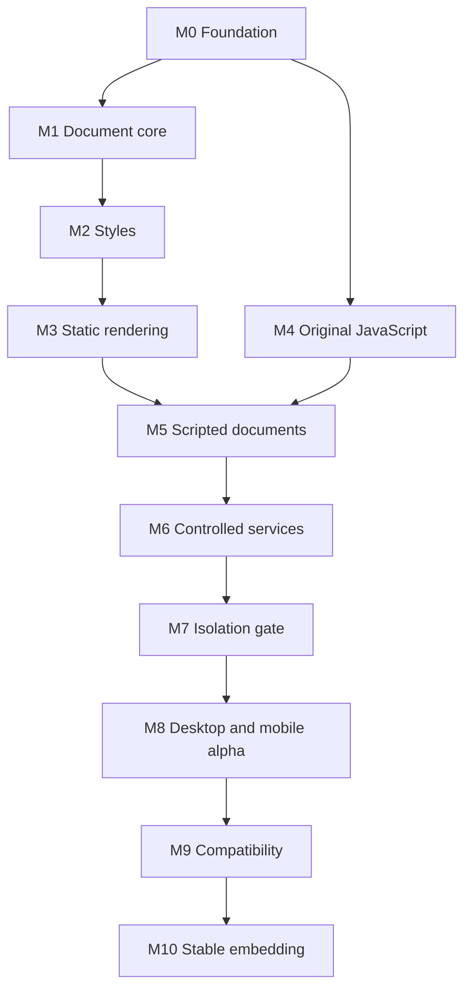

# Implementation roadmap

## 1. Delivery model and scope

The outcome is a new engine, not a wrapper around an existing renderer or JS VM.
Deliver one observable vertical slice at a time. A milestone is complete only
when its demonstration, tests, documentation, and applicable safety gates pass.
Tags identify reproducible prototypes; they do not imply general browser safety.
M0 has a verified repository baseline. M1 implementation has started with DOC-01;
M2–M10 are unstarted. [Implementation progress](IMPLEMENTATION.md) records the
current completed scope without implying completion of the entire milestone.

[PRODUCT.md](PRODUCT.md) makes Brave-level security/privacy, broad website/CSS/JS
coverage, measured Chrome/Firefox improvements, GPU acceleration, WebAssembly,
Rustic-only Manifest V2 extensions and the Rustic uBO port mandatory full-product
targets. [ADR 0007](adr/0007-product-scope.md) supersedes the earlier optional
Wasm/extension scope. No planning checkbox grants implementation credit.

Assume one primary maintainer with occasional contributions. A small team can
work on the independent tracks below after agreeing on interfaces. Full modern
web compatibility is a multi-year program with ongoing maintenance, not a fixed
delivery date. The early effort bands are planning hypotheses for focused work,
not promises; measure actual throughput before assigning calendar deadlines.
Each milestone can span multiple versions and must be split further as evidence
reveals complexity. Later milestones deliberately have no fabricated estimates.

| Milestone | Observable result | Depends on | Initial effort hypothesis |
| --- | --- | --- | --- |
| M0 Foundation | Auditable plan, executable scaffold, CI | Existing license | Days to establish and review |
| M1 Document core | Deterministic URL/HTML/DOM dumps from local fixtures | M0 | Several focused weeks to months |
| M2 Styles | Computed-style dump for a declared CSS subset | M1 DOM contract | Several focused weeks to months |
| M3 Static rendering | Local HTML produces deterministic CPU images | M1, M2 | Several months including text/layout |
| M4 Language runtime | Standalone original JS interpreter with conformance runner | M0; GC interface coordinated with M1 | Many months; can overlap M1–M3 |
| M5 Scripted documents | Events and JS mutations update rendered local pages | M3, M4, traced DOM | Re-estimate after M3/M4 |
| M6 Controlled web services | Fixture-host HTTPS, Fetch policy, cookies and profiles | M5, origin model | Re-estimate after integration prototype |
| M7 Isolated browsing | Enforced broker/renderer isolation on supported platforms | M6, IPC prototypes | Dedicated security program |
| M8 Desktop/mobile alpha | Native hosts, accessibility/inspection, required GPU backend and extension/uBO integration | M7 per platform; local surface prototypes start in M3 | Re-estimate by platform |
| M9 Compatibility expansion | Broad modern site/API coverage, published test results | M8 | Open-ended feature program |
| M10 Embedding and stabilization | Versioned API and maintained beta/release process | Evidence from M8/M9 | Evidence-based release decision |

## 2. Dependency and parallel work strategy

The main integration path is M1 → M2 → M3 → M5 → M6 → M7. The JS track can
proceed independently, but shared tracing and reentry contracts must be decided
before M5, not discovered during binding generation. Parser corpora, Unicode
data, deterministic fixtures, and test runners are good independent work once
their formats are settled. Networking may be prototyped against a fake document
host, but real remote navigation stays behind the M6/M7 gates.

For a small team, name owners for document/rendering, language/bindings,
services/security, and tooling/platforms. A solo maintainer alternates those
roles and keeps only one integration-heavy feature in progress. Weekly review:
demonstrate the current slice, record regressions and risk, and select the next
small task. Re-plan at each milestone gate. This is a workflow recommendation,
not scheduled automation created by this commit.

## 3. M0 — Foundation

- [x] Preserve the license and establish README, design, roadmap, and ADRs.
- [x] Add a small dependency-free Rust workspace with explicit unimplemented status.
- [x] Pin development Rust, declare/test MSRV, and forbid unsafe project code.
- [x] Define CI for formatting, Clippy, docs, builds/tests, and repository checks.
- [x] Configure weekly Dependabot checks for Cargo and GitHub Actions.
- [x] Include Android/iOS in the architecture and configure early shared-core cross-checks; see [mobile plan](MOBILE.md).
- [x] Record a successful baseline CI run ([run](https://github.com/MoeJoe37/Rustic/actions/runs/42371959628)).
- [x] Proceed with the baseline design following maintainer authorization to execute the plan.
- [ ] Configure repository rules requiring the CI gate after it has run once.

**Exit evidence:** clean CI for the committed SHA, CLI `info` works on three
OSes, unsupported navigation errors, and maintainer review of architectural
assumptions. Repository rules are an administrative follow-up; workflow YAML
alone cannot make checks mandatory. No release or parser support is claimed.

## 4. M1 — Document core

| Task | Work and deliverable | Prerequisite |
| --- | --- | --- |
| DOC-01 | Extract typed IDs, budgets, source spans, fake clock/cancellation into base; specify stale-handle behavior | M0 |
| DOC-02 | URL records, relative parsing, normalization, serialization, tuple/opaque origins; import pinned URL test data | DOC-01 |
| DOC-03 | DOM node kinds, document/name/namespace representation, parent-child invariants, ordered attributes | DOC-01 |
| DOC-04 | Insert/remove/adopt/clone operations, traversal, mutation records, document lifecycle tests | DOC-03 |
| DOC-05 | Incremental byte decoding and HTML tokenizer states, entities, raw text, comments, doctype | DOC-01 |
| DOC-06 | Tree-builder insertion modes, implied elements, quirks, tables/foster parenting, formatting recovery and templates | DOC-04, DOC-05 |
| DOC-07 | Local-only bounded loader and deterministic `dump-dom` development command | DOC-02, DOC-06 |
| DOC-08 | Parser corpus runner, node/depth limits, all chunk-boundary regression cases, fuzz target smoke job | DOC-05, DOC-06 |
| DOC-09 | Prototype handle/root/tracing contract with detached trees and cycles before JS integration | DOC-04, language heap design |

**Demo:** dump a malformed local HTML fixture to a stable tree, preserving
namespaces and text; repeat with every possible two-chunk split and obtain the
same result. A file path is granted by the CLI, never by page content.

**Gate:** selected tokenizer/tree-builder corpus passes at a pinned revision;
URL cases are reported separately; document mutation invariants hold; enormous
inputs terminate within budgets; no network access. HTML fragment parsing,
foreign SVG/MathML integration, and script reentry each have explicit status.
Do not label a happy-path tag splitter an HTML implementation.

## 5. M2 — CSS and computed style

| Task | Work and deliverable | Prerequisite |
| --- | --- | --- |
| CSS-01 | CSS syntax tokenizer/parser, escapes, comments, blocks, bad-token recovery, source locations | DOC-01 |
| CSS-02 | Type/universal/ID/class/attribute selectors, combinators, specificity, initial pseudo-classes | CSS-01, DOM views |
| CSS-03 | Typed property parsers: display, box model, color, font basics, lengths/percentages | CSS-01 |
| CSS-04 | UA/user/author origins, importance, inline styles, source order, inheritance and CSS-wide values | CSS-02, CSS-03 |
| CSS-05 | Computed values, stylesheet attachment, style dump, full-restyle reference implementation | CSS-04, DOC-07 |
| CSS-06 | Mutation/viewport invalidation; then media queries, custom properties/variables and cycle handling | CSS-05 |
| CSS-07 | Expand selectors and cascade layers with isolated WPT selections and negative grammar tests | CSS-05 |

**Demo:** a local page with conflicting stylesheet/inline/inherited declarations
produces an inspectable computed-style tree. Unknown properties and unsupported
at-rules recover according to syntax and never silently become supported values.

**Gate:** exact selected declarations/selectors/cascade tests pass, each supported
property has initial/inherited/computed behavior tests, and DOM mutations match
full recomputation. Paint/layout must not invent a second cascade implementation.

## 6. M3 — Static document renderer

| Task | Work and deliverable | Prerequisite |
| --- | --- | --- |
| REN-01 | Typed CSS/device geometry, box tree, anonymous boxes, block flow, margins/padding/borders | CSS-05 |
| REN-02 | Intrinsic sizing, replaced elements, overflow, positioning, floats and margin collapse | REN-01 |
| REN-03 | Font adapter, bundled test fonts, shaping, bidi, line breaking, inline layout and baselines | CSS font values, REN-01 |
| REN-04 | Fragments, stacking contexts, paint order, clips, glyph/image display-list commands | REN-02, REN-03 |
| REN-05 | CPU raster reference backend and bounded image decode; sRGB/alpha conventions | REN-04 |
| REN-06 | `render` headless command, PNG output, layout/display-list dumps, resize and hit testing | REN-05 |
| REN-07 | Reftest harness, checked image fixtures, deterministic clocks/fonts, allocation counters | REN-06 |
| REN-08 | Implement flexbox as its own tested formatting context; start grid/table plans from failures | REN-07 |
| MOB-03/04 | Android/iOS local-fixture CPU surfaces through narrow native bridges | REN-05; mobile core checks |

**Demo:** local article, styled cards, inline image, nested blocks, Arabic/Latin
mixed text, resize, and overflow render through Rustic's pipeline. Early debug
text rendering is allowed while shaping is built but is labeled incomplete.

**Gate:** selected layout and reftests pass; repeated renders match within the
declared font/backend tolerance; negative dimensions and decompression bombs fail
within limits; no live network. SVG, MathML layout, tables, print, vertical writing,
and advanced effects remain separately tracked instead of implied by HTML support.

## 7. M4 — Original ECMAScript runtime

| Task | Work and deliverable | Prerequisite |
| --- | --- | --- |
| JS-01 | Lexer/parser, lexical goals, AST, source spans, early errors, strict mode, ASI and UTF-16 string model | M0 |
| JS-02 | Values, coercions, environments, references, completion records, object internal methods/descriptors | JS-01 |
| JS-03 | Nonmoving traced heap, root scopes, cyclic objects, weak host handles and resource budgets | JS-02, DOC-09 coordination |
| JS-04 | Interpreter/initial bytecode, expressions, control flow, functions, closures, calls/new, exceptions | JS-02, JS-03 |
| JS-05 | Core built-ins, arrays, strings, numbers, symbols, iterators and collections | JS-04 |
| JS-06 | Promise jobs, realms, module records/loading hooks and dynamic imports without ambient I/O | JS-04 |
| JS-07 | Standalone JS runner and pinned Test262 harness, strict/raw/module/negative/async metadata handling | JS-04 |
| JS-08 | BigInt, RegExp, typed arrays/buffers, proxies, generators/async, Intl in explicitly measured increments | JS-05–JS-07 |

**Demo:** closures, exceptions, prototypes, cyclic objects, and promises run in the
standalone runner. Unsupported syntax is rejected deliberately, not partially
executed. The engine never delegates execution to another JS runtime.

**Gate:** published selected Test262 results include upstream revision, total
selected/run/pass/fail/skipped/crash/timeout counts, with expected failures kept
visible. GC stress proves reachable host cycles survive and unreachable cycles
are reclaimed. Infinite execution is cancellable. Parser subsets must not be
advertised as complete ECMAScript support. No JIT until a separate measured ADR.

The required Wasm track starts after values/heap/execution foundations, follows
WASM-01–08 in [PRODUCT.md](PRODUCT.md), and integrates with M5 host policy. Its
decoder/validator/interpreter can be tested independently; full JS/Web binding,
baseline feature and mobile gates remain mandatory through M9.

## 8. M5 — Scripted document integration

| Task | Work and deliverable | Prerequisite |
| --- | --- | --- |
| WEB-01 | Agent/task sources, microtask checkpoints, safe points, fake clock/timers and cancellation | JS-06, engine lifecycle |
| WEB-02 | Web IDL subset generator and conversions, wrapper identity, DOM/JS tracing and exceptions | DOC-09, JS-03 |
| WEB-03 | Window/Document/Element bindings, DOM mutation/traversal and basic selectors | WEB-02, CSS-02 |
| WEB-04 | Event propagation, listeners, default actions, click/key input, timers and animation frames | WEB-01, WEB-03 |
| WEB-05 | Classic script lifecycle, parser blocking, async/defer/module order and document readiness | DOC-06, WEB-01–WEB-03 |
| WEB-06 | Style/layout invalidation, read-induced layout flush, frame epochs and resource completion ordering | M3, WEB-03 |
| WEB-07 | Basic forms/focus, mutation observers, console/errors and script debugging hooks | WEB-04–WEB-06 |

**Demo:** a local scripted counter, form validation fixture, timer, event bubbling,
and DOM/style mutation update the rendered surface deterministically.

**Gate:** selected event/task ordering tests pass, getters/callbacks can reenter
without borrow failures, detached DOM cycles are collected, and navigation/close
cancels pending work. API exposure is driven by implemented bindings. The mere
presence of a property does not count as correct API support.

## 9. M6 — Controlled networking and browser services

| Task | Work and deliverable | Prerequisite |
| --- | --- | --- |
| NET-01 | Reviewed transport/TLS choice, loopback fixture server, cancellation/timeouts/streaming/backpressure | DOC-02, base budgets |
| NET-02 | Navigation state machine, redirects, response MIME/encoding, referrer/policy container propagation | M5, NET-01 |
| NET-03 | Fetch requests/responses, response tainting, CORS/preflight, credentials, origin checks | NET-02 |
| NET-04 | Cookie jar, secure/HTTP-only/SameSite semantics, partitioned HTTP cache and validators | NET-03 |
| NET-05 | CSP for implemented execution/loading paths, mixed content, secure context and certificate errors | NET-02, WEB-05 |
| NET-06 | Ephemeral/disk profiles, partition keys, quotas, versioned schemas, private mode, local storage | NET-04, origin model |
| NET-07 | History, reload/back/forward, forms navigation, downloads broker contract, basic WebSocket plan | NET-02–NET-06 |

**Demo:** an explicit allowlist of test-server origins loads a page with styles,
scripts, images, redirects, a cookie, and fetch requests; a cross-origin access
fixture is denied. Tests use an isolated profile, not personal browsing data.

**Gate:** certificate verification never has a silent bypass, redirect policies
are rechecked, origin/storage/cache separation and response filtering tests pass,
and parser/resource limits cover streaming/decompression. This is a development
network prototype. General remote browsing is still gated on M7.

## 10. M7 — Isolation and security gate

- **ISO-01:** specify browsing-context/site/agent process assignment, same-origin
  access and cross-origin frames, opener relationships, and isolation transitions.
- **ISO-02:** versioned bounded IPC, hostile-peer tests, broker capabilities,
  process lifecycle, shared-memory validation, and cancellation on process death.
- **ISO-03:** implement and verify Linux sandbox restrictions; prohibit direct
  renderer filesystem/network/device access and broker only permitted operations.
- **ISO-04:** implement Windows isolation; evaluate macOS restrictions with a
  platform ADR. Gate remote browsing separately on each platform's actual status.
- **ISO-08 / MOB-07:** define Android application/service and iOS supported engine-
  extension isolation, brokering and crash recovery. Verify OS capabilities and
  applicable entitlements rather than assuming desktop sandbox/JIT mechanisms.
- **ISO-05:** protect permission prompts, trusted address display, clipboard and
  download/file access; require genuine user activation where applicable.
- **ISO-06:** review attack surfaces, fuzz IPC/decoders/parsers, run sanitizer/GC
  stress jobs, test renderer compromise assumptions and site/profile separation.
- **ISO-07:** exercise renderer/network/GPU crashes and restart without stale
  capabilities, sensitive state leakage, or whole-browser failure.

**Demo:** kill or simulate compromise of a renderer; chrome survives and forbidden
file/network/other-site operations fail at the OS or broker boundary.

**Gate:** all applicable [security gates](SECURITY.md) pass with recorded evidence
and focused external review where available. Unresolved sandbox escapes, origin
confusion, or native memory issues block remote browsing. A failed sandbox setup
is an explicit error, not a reason to launch an unsandboxed renderer silently.

## 11. M8 — Reference desktop and mobile alpha

- **UI-01:** desktop shell with address entry, tabs, loading/error state, history,
  profiles, zoom, find, downloads and permission UI; keep chrome separate from DOM.
- **UI-02:** platform window/event loop/surface integration on Linux, then Windows
  and macOS, plus Android/iOS native hosts when each runtime meets its gates.
  Shared mobile checks start in M1 and local CPU surfaces in M3, per
  [MOB-01–MOB-10](MOBILE.md). Document actual platform differences and status.
- **UI-03:** accessibility roles/names/focus/state tree, keyboard navigation,
  selection, IME/composition, clipboard grants and platform accessibility bridges.
- **UI-04:** inspector DOM/style/layout views, console, network diagnostics,
  source breakpoints and timeline; debug access disabled by default remotely.
- **UI-05:** incremental painting, scroll/compositor scenes, GPU prototype with
  CPU fallback, device-loss recovery and parity fixtures.
- **UI-06:** headless automation protocol and a WPT runner adapter; record a
  reproducible selected WPT baseline and real-world fixture failures.

**Demo:** a reproducible curated site corpus works in an isolated desktop alpha,
then native Android/iOS hosts with touch/IME, lifecycle and accessibility checks.
Record each platform's actual status; alpha labels list known limitations.

**Gate:** critical accessibility flows, crash recovery, profile separation,
supported-platform safety gates, and agreed performance budgets pass. Do not
declare broad site compatibility from a small handpicked demo collection.

## 12. M9 — Compatibility expansion program

Prioritize measured site breakage and standards coverage, not feature count. Each
workstream gets an owner, scoped specification, fixture corpus, and gate:

| Workstream | Scope and order | Required evidence |
| --- | --- | --- |
| CSS/layout | Full flex/grid/tables; writing modes; fragmentation/printing; container queries; animations/transforms/effects | WPT reftests plus incremental/full-layout parity |
| Document formats | SVG parsing/DOM/painting, MathML layout, XML where supported | Separate format conformance and hostile-input corpora |
| Language | Remaining ECMAScript semantics and built-ins, RegExp/Intl; optimization after correctness | Test262 full-selection reporting; GC/stack stress |
| Platform APIs | Streams, workers, structured clone, messaging, URL APIs, encoding, observers | Agent/task/cross-origin tests |
| Offline/data | IndexedDB, Cache API, service workers and update/lifetime rules | Transaction/crash-recovery and partition tests |
| Graphics/media | Canvas 2D; audio/video with reviewed codecs; then evaluate WebGL/WebGPU | Rendering/codec corpora, permissions and sandbox review |
| Network | HTTP/2 and HTTP/3 via reviewed transports, WebSockets, cache/cookie compatibility | Protocol fixtures, cancellation and cross-origin tests |
| Modern execution | Required original Wasm runtime and JS/Web integration; WASM-01–08 | Core/JS/Web suites, bounded execution, reviewed acceleration and interpreter fallback |
| Native extensions | Rustic-only MV2 platform, background/content worlds, blocking requests and mobile lifecycle; EXT-01–10 | Signed-package, permission/revocation, API and hostile-extension corpus |
| uBlock Origin port | Required full-feature Rustic port, broker filtering, UI and list updates; BLK-01–08 | Pinned upstream feature matrix, reference/optimized parity, hostile-list and device tests |
| Usability | Full editing/contenteditable, IME, accessibility parity, printing | Platform/manual automation and assistive-technology evidence |
| Site compatibility | Versioned representative static/dynamic site corpus, regression triage | Reproducible outcomes, explicit scope and test denominators |

GPU delivery is required, with per-platform parity/recovery and energy measurements.
The extension/filtering tracks start contract prototypes in M5/M6, require M7
authority/isolation, and reach product acceptance in M8/M9. Follow [EXTENSIONS.md](EXTENSIONS.md).
They must not delay the first static renderer or scripted local document.
Sync/accounts, a password manager and a general native plugin ABI remain separate
scope decisions. Track DRM/proprietary-service compatibility constraints explicitly
rather than promising access that depends on third-party eligibility.

Android and iOS are in scope from early core design. Their native hosts and
runtime gates follow the same engine milestones, rather than being optional ports.

## 13. M10 — Embedding, releases, and maintenance

Stabilize the Rust embedding API after at least two distinct hosts exercise it.
Document thread affinity, ownership, cancellation, event ordering, error taxonomy,
capabilities, and shutdown. Add a versioned C ABI only if an actual embedder needs
it. Adopt semver and deprecation rules when the public contract is ready.

Release work includes reproducible source/build metadata, dependency inventory
and notices, SBOM, signed/checksummed artifacts, platform smoke tests, release
notes, upgrade/migration tests, and a security update policy. Automate publication
only after artifact contents and release authority are decided; this first commit
does not publish packages, releases, or binaries.

**Beta gate:** agreed compatibility corpus and supported WPT/Test262 scope have
no unexplained regressions; supported-platform security gates and accessibility
flows pass; reproducible builds and incident handling are exercised. Full web
compatibility is not inferred from a version number.

**Full-product gate:** all [PRODUCT.md](PRODUCT.md) acceptance criteria pass,
including the dated Brave security/privacy comparison, required standards/site
coverage, five-platform GPU/Wasm and MV2/uBO operation, and controlled competitive
measurements. Targets and measured results are reported separately. Final 100%
progress cannot bypass these gates.

## 14. First implementation queue

These are issue-ready tasks, not GitHub issues created by this commit. First
review M0 and confirm the selected original-engine scope. Then work in order:

| Order | Task / suggested issue title | Concrete completion test |
| --- | --- | --- |
| 1 | DOC-01a: Add typed document/node IDs with generation validation | Reusing an arena slot cannot revive a stale node handle |
| 2 | DOC-01b: Add input/node/depth budgets and cancellation | Exact limit accepted, next value rejected, cancellation terminates work |
| 3 | DOC-03: Implement minimal document arena and node kinds | Parent/child invariants survive insert/remove and invalid operations |
| 4 | DOC-04a: Add DOM mutation and deterministic tree serializer | Same tree emits identical bytes; moves cannot create cycles |
| 5 | DOC-02a: Implement URL records and tuple/opaque origin types | Relative resolution/serialization fixtures and opaque identity tests |
| 6 | DOC-05a: Implement incremental tokenizer data/tag/comment states | Chunked/unbroken token sequences match for every fixture split |
| 7 | DOC-05b: Add entities, raw/RCDATA/script text and encoding cases | Pinned tokenizer subset with errors and malformed inputs |
| 8 | DOC-06a: Implement initial/before-html/head/body insertion modes | Implied-node and malformed nesting tree fixtures |
| 9 | DOC-06b: Add table and formatting recovery modes | Foster-parenting/adoption-agency regression corpus |
| 10 | DOC-07: Expose a bounded local `dump-dom` CLI command | Fixture dump snapshot; URL and unauthorized file inputs rejected |
| 11 | DOC-08: Add corpus runner and parser fuzz smoke workflow | Seed replay works; crashes/timeouts fail CI and retain reproducers |
| 12 | DOC-09: Review traced node/JS host-object ownership prototype | Reachable detached tree survives; unreachable cross-object cycles disappear |

For every issue include task ID, dependencies, specification section/revision,
in/out scope, input/output contract, acceptance fixtures, budget behavior, and
documentation to update. A task should fit a reviewable PR; split further before
coding when it spans multiple unrelated contracts.

## 15. Definition of done and risk register

A change is done when the implementation, focused negative/regression tests,
relevant conformance selection, diagnostics, budget/cancellation behavior, docs,
and required CI pass. Unsupported semantics are reported honestly. New expected
failures need a reason and tracking item. Never hide failures by shrinking a suite
without recording the changed denominator. Security-boundary changes get focused
review and a threat-model update; dependency additions get a boundary review.

| Risk | Early signal | Response / decision gate |
| --- | --- | --- |
| Scope exceeds maintainer capacity | Long-lived branches; no runnable slice | Cut milestone scope, keep static/local demos, defer late APIs |
| Parser compatibility underestimated | Frequent malformed-tree differences | Prioritize spec recovery and corpus tests before features |
| DOM/GC design causes leaks or stale access | Detached tree leaks or GC stress failures | Resolve DOC-09/JS-03 before generating broad bindings |
| Layout/text consumes schedule | Font/platform-dependent diffs | Deterministic fonts, shaped-text contract, small formatting contexts |
| JS semantic tail dominates | Test262 failures cluster around abstract operations | Fix shared semantics; publish subset; defer optimization |
| Async/reentry corruption | Stale frames, borrow failures, callbacks after close | Epochs, fake scheduler tests, explicit safe points |
| Sandbox unavailable on a platform | Renderer retains ambient access | Gate remote mode on that OS; investigate separately |
| Native dependency or decoder compromise | New unsafe/FFI surface or advisories | Minimize dependencies, isolate, audit/fuzz, update promptly |
| Flaky or expensive CI | Random image diffs; excessive runner minutes | Stable fixtures, bounded required checks, scheduled heavy suites |
| Performance optimized prematurely | Complex caches before correct output | Keep reference path; require profiles and parity evidence |
| Upstream standards/tests change | Baseline shifts without code changes | Pin revisions; update in reviewed changes with before/after counts |
