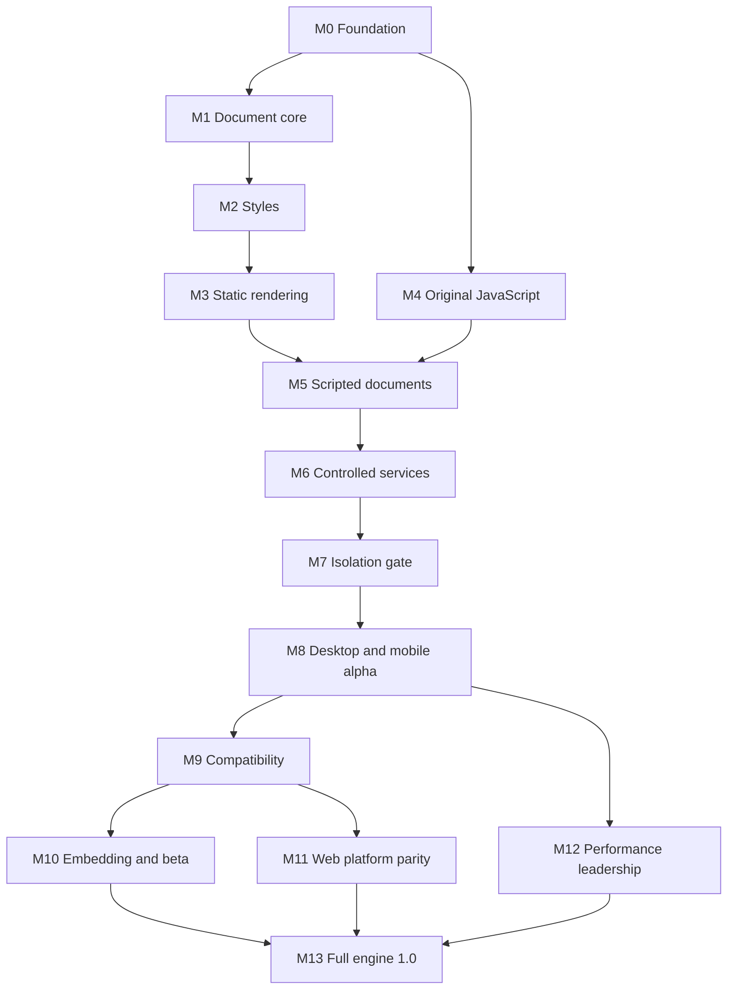

# Implementation roadmap

## 1. Delivery model and scope

The outcome is a new engine, not a wrapper around an existing renderer or JS VM.
Deliver one observable vertical slice at a time. A milestone is complete only
when its demonstration, tests, documentation, and applicable safety gates pass.
Tags identify reproducible prototypes; they do not imply general browser safety.

**Status (2026-11-16).** M0 has a verified baseline; only the repository-rules
follow-up is open. M1, M2, M3 and M4 are complete for their declared catalog
scope: local HTML parses, styles, lays out, shapes text, paints and rasterizes
to PNG on the CPU, and Rustic's own ECMAScript engine (JS-01 to JS-09, with
Intl) runs scripts ([JS.md](JS.md)). The M4 ARM64 benchmark record is from
QEMU emulation; native ARM64 timings are TD-125. M5 is the current milestone,
with the task scheduler and the first DOM bindings in place. M6–M13 are
unstarted. Native Android/iOS surfaces (MOB-03/04) did not land with M3 and are
carried forward (see [§6](#6-m3--static-document-renderer)). The
[progress summary](progress/summary.md) is the measured status and
[implementation progress](IMPLEMENTATION.md) records each completed contract;
neither implies more than its declared scope.

[PRODUCT.md](PRODUCT.md) makes Brave-level security/privacy, broad website/CSS/JS
coverage, GPU acceleration, WebAssembly, Rustic-only Manifest V2 extensions and
the Rustic uBO port mandatory full-product targets. [ADR 0007](adr/0007-product-scope.md)
supersedes the earlier optional Wasm/extension scope.

**End goal.** The roadmap ends in a fully working engine that has the
functionality of the other browser engines (Blink, Gecko and WebKit) and is
faster and leaner than all three. M1–M10 build the engine and a beta;
[M11](#14-m11--web-platform-parity) closes the remaining feature gap against a
pinned inventory of everything those engines ship;
[M12](#15-m12--performance-leadership) turns the measured performance targets
into gates against all three engines; [M13](#16-m13--full-engine-10) is the
final acceptance on every platform. [ADR 0018](adr/0018-parity-and-performance-leadership.md)
records this scope. No planning checkbox grants implementation credit.

Assume one primary maintainer with occasional contributions. A small team can
work on the independent tracks below after agreeing on interfaces. Full modern
web compatibility is a multi-year program with ongoing maintenance, not a fixed
delivery date. The early effort bands are planning hypotheses for focused work,
not promises; measure actual throughput before assigning calendar deadlines.
Each milestone can span multiple versions and must be split further as evidence
reveals complexity. Later milestones deliberately have no fabricated estimates.

| Milestone | Observable result | Depends on | Initial effort hypothesis |
| --- | --- | --- | --- |
| M0 Foundation | Auditable plan, executable scaffold, CI | Existing license | Days to establish and review |
| M1 Document core | Deterministic URL/HTML/DOM dumps from local fixtures | M0 | Several focused weeks to months |
| M2 Styles | Computed-style dump for a declared CSS subset | M1 DOM contract | Several focused weeks to months |
| M3 Static rendering | Local HTML produces deterministic CPU images | M1, M2 | Several months including text/layout |
| M4 Language runtime | Standalone original JS interpreter with conformance runner | M0; GC interface coordinated with M1 | Many months; can overlap M1–M3 |
| M5 Scripted documents | Events and JS mutations update rendered local pages | M3, M4, traced DOM | Re-estimate after M3/M4 |
| M6 Controlled web services | Fixture-host HTTPS, Fetch policy, cookies and profiles | M5, origin model | Re-estimate after integration prototype |
| M7 Isolated browsing | Enforced broker/renderer isolation on supported platforms | M6, IPC prototypes | Dedicated security program |
| M8 Desktop/mobile alpha | Native hosts, accessibility/inspection, required GPU backend and extension/uBO integration | M7 per platform; local surface prototypes start in M3 | Re-estimate by platform |
| M9 Compatibility expansion | Broad modern site/API coverage, published test results | M8 | Open-ended feature program |
| M10 Embedding and beta | Versioned API and maintained beta/release process | Evidence from M8/M9 | Evidence-based release decision |
| M11 Web platform parity | Every feature Blink, Gecko or WebKit ships is implemented or has a reviewed decision; WPT/Test262 pass rates at least the best engine's | M9; media/graphics/device tracks can start after M8 | Multi-year feature program |
| M12 Performance leadership | Faster, leaner and more energy-efficient than all three engines on pinned benchmarks and reference devices | M8 harness and alpha; JIT after M7 isolation | Multi-year optimization program |
| M13 Full engine 1.0 | All product, parity, performance and security gates pass on all five platform families | M10, M11, M12 | Evidence-based release decision |

## 2. Dependency and parallel work strategy

The main integration path is M1 → M2 → M3 → M5 → M6 → M7. The JS track can
proceed independently, but shared tracing and reentry contracts must be decided
before M5, not discovered during binding generation. Parser corpora, Unicode
data, deterministic fixtures, and test runners are good independent work once
their formats are settled. Networking may be prototyped against a fake document
host, but real remote navigation stays behind the M6/M7 gates. M11 and M12 run
in parallel after the alpha: parity work adds features, leadership work makes
the existing ones faster, and each keeps the other's gates green. Performance
is measured from M5 onward (PERF-01), so M12 starts from years of numbers, not
from a late optimization push.

For a small team, name owners for document/rendering, language/bindings,
services/security, and tooling/platforms. A solo maintainer alternates those
roles and keeps only one integration-heavy feature in progress. Weekly review:
demonstrate the current slice, record regressions and risk, and select the next
small task. Re-plan at each milestone gate. This is a workflow recommendation,
not scheduled automation created by this commit.

## 3. M0 — Foundation

- [x] Preserve the license and establish README, design, roadmap, and ADRs.
- [x] Add a small dependency-free Rust workspace with explicit unimplemented status.
- [x] Pin development Rust, declare/test MSRV, and forbid unsafe project code.
- [x] Define CI for formatting, Clippy, docs, builds/tests, and repository checks.
- [x] Configure weekly Dependabot checks for Cargo and GitHub Actions.
- [x] Include Android/iOS in the architecture and configure early shared-core cross-checks; see [mobile plan](MOBILE.md).
- [x] Support any device that can run a browser: native x64/ARM64 tests on Linux, Windows and macOS, emulated 32-bit ARM/x86, RISC-V and big-endian tests, and further cross-checks; see [platform support](PLATFORMS.md) and ADR 0013.
- [x] Record a successful baseline CI run ([run](https://github.com/MoeJoe37/Rustic/actions/runs/42371959628)).
- [x] Proceed with the baseline design following maintainer authorization to execute the plan.
- [ ] Configure repository rules requiring the CI gate after it has run once.

**Exit evidence:** clean CI for the committed SHA, CLI `info` works on three
OSes, unsupported navigation errors, and maintainer review of architectural
assumptions. Repository rules are an administrative follow-up; workflow YAML
alone cannot make checks mandatory. No release or parser support is claimed.

## 4. M1 — Document core

| Task | Work and deliverable | Prerequisite |
| --- | --- | --- |
| DOC-01 | Extract typed IDs, budgets, source spans, fake clock/cancellation into base; specify stale-handle behavior | M0 |
| DOC-02 | URL records, relative parsing, normalization, serialization, tuple/opaque origins; import pinned URL test data | DOC-01 |
| DOC-03 | DOM node kinds, document/name/namespace representation, parent-child invariants, ordered attributes | DOC-01 |
| DOC-04 | Insert/remove/adopt/clone operations, traversal, mutation records, document lifecycle tests | DOC-03 |
| DOC-05 | Incremental byte decoding and HTML tokenizer states, entities, raw text, comments, doctype | DOC-01 |
| DOC-06 | Tree-builder insertion modes, implied elements, quirks, tables/foster parenting, formatting recovery and templates | DOC-04, DOC-05 |
| DOC-07 | Local-only bounded loader and deterministic `dump-dom` development command | DOC-02, DOC-06 |
| DOC-08 | Parser corpus runner, node/depth limits, all chunk-boundary regression cases, fuzz target smoke job | DOC-05, DOC-06 |
| DOC-09 | Prototype handle/root/tracing contract with detached trees and cycles before JS integration | DOC-04, language heap design |

**Demo:** dump a malformed local HTML fixture to a stable tree, preserving
namespaces and text; repeat with every possible two-chunk split and obtain the
same result. A file path is granted by the CLI, never by page content.

**Gate:** selected tokenizer/tree-builder corpus passes at a pinned revision;
URL cases are reported separately; document mutation invariants hold; enormous
inputs terminate within budgets; no network access. HTML fragment parsing,
foreign SVG/MathML integration, and script reentry each have explicit status.
Do not label a happy-path tag splitter an HTML implementation.

**Status:** complete. DOC-01 to DOC-09 are done for their declared scope; see
[implementation progress](IMPLEMENTATION.md). Remaining DOM/HTML work is
scheduled where it is needed: mutation records/observers, events and parser
script reentry (`dom.observers`, `dom.events`, `html.scripts`) are M5 gates.

## 5. M2 — CSS and computed style

| Task | Work and deliverable | Prerequisite |
| --- | --- | --- |
| CSS-01 | **Done** ([CSS.md](CSS.md)): CSS syntax tokenizer/parser, escapes, comments, blocks, bad-token recovery, source locations | DOC-01 |
| CSS-02 | **Done** ([CSS.md](CSS.md#selectors)): type/universal/ID/class/attribute selectors, combinators, specificity, initial pseudo-classes, DOM matching | CSS-01, DOM views |
| CSS-03 | **Done** ([CSS.md](CSS.md#property-values)): typed property parsers: display, box model, color, font basics, lengths/percentages | CSS-01 |
| CSS-03b | **Done** ([CSS.md](CSS.md#math-functions)): `calc()`, `min()`, `max()`, `clamp()` for lengths, length-percentages and numbers, with computed values | CSS-03 |
| CSS-03c | **Done** ([CSS.md](CSS.md#property-values)): positioning, overflow, visibility, opacity, text and decoration longhands, `font` and `background` shorthands, with computed values | CSS-03b |
| CSS-04 | **Done** ([CSS.md](CSS.md#cascade)): UA/user/author origins, importance, inline styles, source order, inheritance and CSS-wide values | CSS-02, CSS-03 |
| CSS-05 | **Done** ([CSS.md](CSS.md#computed-style)): computed values, stylesheet attachment, style dump, full-restyle reference implementation | CSS-04, DOC-07 |
| CSS-06 | **Done** ([CSS.md](CSS.md#media-queries)): media queries, mutation/viewport invalidation, custom properties with `var()` and cycle handling, `@property` registration with font-relative unit cycles, and container queries (sizes supplied by the caller until layout). Font-metric units (`ex`/`ch`/`cap`/`ic`) use spec fallbacks until REN-03 loads fonts | CSS-05 |
| CSS-07 | **Done**: CSS-07a ([CSS.md](CSS.md#selectors)) adds `:has()`, form states, `:lang()`/`:dir()`, nesting `&` and nested rules, pseudo-element states; CSS-07b adds cascade layers, shadow-tree contexts and animation origins. Slots, `::slotted()`/`::part()` and `@import layer()` remain | CSS-05 |
| CSS-08 | **Done** ([CSS.md](CSS.md#conformance-gate)): declared conformance gate over pinned WPT parsing cases for selectors and supported properties, with a reviewed ratchet expectation list | CSS-07a |

**Demo:** a local page with conflicting stylesheet/inline/inherited declarations
produces an inspectable computed-style tree. Unknown properties and unsupported
at-rules recover according to syntax and never silently become supported values.

**Gate:** exact selected declarations/selectors/cascade tests pass, each supported
property has initial/inherited/computed behavior tests, and DOM mutations match
full recomputation. Paint/layout must not invent a second cascade implementation.

**Status:** complete for the declared subset and gate (CSS-08 ratchet). Broader
CSS compatibility is M9 work.

## 6. M3 — Static document renderer

| Task | Work and deliverable | Prerequisite |
| --- | --- | --- |
| REN-01 | **Done** ([LAYOUT.md](LAYOUT.md)): typed CSS/device geometry, box tree, anonymous boxes, block flow, margins/padding/borders | CSS-05 |
| REN-02 | **Done** ([LAYOUT.md](LAYOUT.md)): intrinsic sizing, replaced elements, overflow, positioning (including sticky), floats and margin collapse; REN-02c adds intrinsic keywords and replaced sizing | REN-01 |
| REN-03 | **Done** ([TEXT.md](TEXT.md)): font adapter (TrueType, CFF/CFF2, WOFF1/2 via ADR 0014), bundled test fonts, host-granted discovery, GSUB/GPOS shaping with Arabic/Indic, bidi, line breaking/hyphenation, inline layout and baselines, computed `ex`/`ch`/`cap`/`ic`; TD-85/86/87 record remaining refinements | CSS font values, REN-01 |
| REN-04 | **Done** ([PAINT.md](PAINT.md)): fragments, stacking contexts, paint order, clips, text/image/decoration/outline commands, rounded corners, clip paths, transforms, shadows, blending and filters | REN-02, REN-03 |
| REN-05 | **Done** ([PAINT.md](PAINT.md)): CPU raster reference backend, tiling and damage; bounded inflate, PNG, JPEG, GIF and WebP decoding with an image store | REN-04 |
| REN-06 | **Done**: `render` headless command, PNG output, layout/display-list dumps, resize/zoom and `hit-test` | REN-05 |
| REN-07 | **Done for the declared gate**: `reftest` harness with fuzzy tolerances, checked fixtures, deterministic fonts; the `frame_budget` example measures repaint time | REN-06 |
| REN-08 | **Done for the declared scope** ([LAYOUT.md](LAYOUT.md#flexbox-ren-08)): block, text and `inline-flex` items; 38 of 91 pinned static css-flexbox WPT pages pass (TD-72). Grid and tables are M9 work | REN-07 |
| MOB-03/04 | **Not done; carried forward.** Android/iOS local-fixture CPU surfaces through narrow native bridges. They need NDK/Xcode link and device runs that the current CI cannot provide. Target: land before M5 closes, as a parallel platform track that does not block M4 | REN-05; mobile core checks |

**Status:** the M3 catalog gate (17 capabilities) is complete: block, inline and
flex layout, positioned/replaced content, glyph/image paint, CPU raster,
resize/zoom, hit testing and pinned layout/reftest gates. It does not claim full
web compatibility (M9) or native Android/iOS surface acceptance (MOB-03/04
above, then M8). See [TEXT.md](TEXT.md), [LAYOUT.md](LAYOUT.md),
[PAINT.md](PAINT.md) and the [M3 completion review](reviews/2026-11-10-m3-completion.md).

**Demo:** local article, styled cards, inline image, nested blocks, Arabic/Latin
mixed text, resize, and overflow render through Rustic's pipeline. Early debug
text rendering is allowed while shaping is built but is labeled incomplete.

**Gate:** selected layout and reftests pass; repeated renders match within the
declared font/backend tolerance; negative dimensions and decompression bombs fail
within limits; no live network. SVG, MathML layout, tables, print, vertical writing,
and advanced effects remain separately tracked instead of implied by HTML support.

## 7. M4 — Original ECMAScript runtime

M4 builds Rustic's own JavaScript engine. JavaScript is usually the largest
consumer of memory and CPU in a page, so M4 is planned for a small heap and a
fast interpreter from the first value type, not as a later optimization pass.
Rustic will not have a JIT in M4, and some platforms (iOS outside special
browser-engine entitlements, locked-down devices) do not allow one at all, so
interpreter speed and heap size are the performance of the product everywhere.

| Task | Work and deliverable | Catalog | Prerequisite | Status |
| --- | --- | --- | --- | --- |
| JS-01 | Lexer/parser, lexical goals, AST, source spans, early errors, strict mode, ASI and UTF-16 string model | `js.parser` | M0 | **Done** ([JS.md](JS.md)); RegExp pattern early errors were added by JS-08 (TD-88 paid) |
| JS-02 | 8-byte values, coercions, references, completion records, strings and atoms, shapes, object internal methods/descriptors and elements | `js.values`, `js.objects` | JS-01 | **Done** for the data model ([JS.md](JS.md#runtime-data-model-js-02), ADR 0015); collection is JS-03, BigInt conversions came with JS-08 part 4 |
| JS-03 | Heap: typed arenas with `u32` indices charged to a budget, handle scopes/roots, nonmoving mark/sweep, weak references, allocation-triggered collection, host-object tracing that replaces the DOC-09 `HostHeap` stand-in | `js.heap` | JS-02, DOC-09 (done) | **Done**: mark/sweep, roots, free lists, shape/atom collection, policy and stress mode, weak references, host tracing and the shared DOM/JS collection ([ADR 0016](adr/0016-js-garbage-collection.md)); allocation-triggered collection is at safe points only (TD-94) |
| JS-04 | Bytecode compiler and interpreter: AST to register bytecode, control flow, functions, closures, calls/new, exceptions, property inline caches | `js.interpreter`, `js.functions` | JS-02, JS-03 | **Done**: scripts compile to register bytecode and run with functions, closures, calls/`new`, exceptions, iteration, limits, cancellation and inline caches ([ADR 0017](adr/0017-js-bytecode-interpreter.md)); classes with `extends`, `super`, fields, static blocks and private names; object-literal `super`, tagged templates and optional calls; generators, async functions and RegExp literals run (JS-06/JS-08); static modules, top-level await and dynamic imports run (JS-06) |
| JS-05 | Core built-ins, arrays, strings, numbers, symbols, iterators, JSON, collections | `js.builtins` | JS-04 | **In progress**: Error and the native errors, `Object`, `Function` (constructor, `call`/`apply`/`bind`), `Array`, `String`, `Number`, `Math`, `JSON`, `Map`, `Set`, weak collections, `Reflect`, `Date`, iterator helpers, `eval`, `Symbol` statics, global functions and the primitive wrapper constructors ([JS.md](JS.md#built-ins-js-05)), 88.9% of the Test262 built-ins tests for those areas; function source text follows (TD-106, TD-107) |
| JS-06 | Promise jobs, realms, module records/loading hooks and dynamic imports without ambient I/O | `js.jobs`, `js.modules` | JS-04 | **Done**: `Promise`, the job queue and async functions run (part 1, [JS.md](JS.md)); promise rejection tracking (part 2) and [static module records and graph resolution](JS.md#static-module-loading-js-06) are implemented; module environments, live bindings, namespaces and synchronous evaluation, host-provided string metadata and top-level await and dynamic imports run; [realms](JS.md#realms-js-06) with per-realm intrinsics and `$262.createRealm` are implemented |
| JS-07 | Standalone runner and pinned Test262 harness: strict/raw/module/negative/async metadata, per-test time and memory limits | evidence for `js.conformance` (M9) | JS-04 | **In progress**: the runner executes `test/language` with deterministic step and heap limits and an exact passing list (21,939 of 22,427 run files, 97.8%) and the JS-05/JS-06/JS-08 areas of `test/built-ins` (17,291 of 18,574, 93.1%); the separate module gate has 696 passes of 696 executed, with 121 proposal skips; `$262.evalScript` runs in the current global environment; the rest of `test/built-ins` follow (TD-105) |
| JS-08 | BigInt, RegExp (own backtracking-bounded engine, pays TD-88), proxies, generators/async, typed arrays/buffers, Intl, in measured increments | `js.advanced`, `js.buffers`, `js.intl` | JS-05–JS-07 | **In progress**: generators (part 1), async generators with `for await` (part 2) and RegExp (part 3, TD-88 paid; property escapes are TD-110), BigInt (part 4, TD-92 paid) and proxies with mapped `arguments` objects (part 5) and ArrayBuffer, DataView and typed arrays (part 6) and SharedArrayBuffer and Atomics within one agent (part 7; cross-agent sharing is TD-115) run ([JS.md](JS.md)); Unicode normalization, locale identifiers, locale-sensitive casing, `Intl.Locale`, `Intl.ListFormat`, shared locale negotiation and [`Intl.Collator` with `localeCompare`](JS.md#intl-collation-js-08) [`Intl.PluralRules`](JS.md#intl-plural-rules-js-08) [`Intl.NumberFormat` with number `toLocaleString`](JS.md#intl-number-formatting-js-08) [`Intl.RelativeTimeFormat`](JS.md#intl-relative-time-formatting-js-08) [`Intl.DisplayNames`](JS.md#intl-display-names-js-08) [`Intl.DurationFormat`](JS.md#intl-duration-formatting-js-08) and [`Intl.Segmenter`](JS.md#intl-segmentation-js-08) are implemented. [`Intl.DateTimeFormat` and `Intl.supportedValuesOf`](JS.md#intl-date-and-time-formatting-js-08) are implemented for the supported calendars and data. Full collation tailorings (TD-107) and remaining calendar, zone-name and date-pattern work (TD-122) are open |
| JS-09 | Limits and performance gate: cancellation, JS stack and heap limits, GC stress mode, the JS benchmark corpus and heap-size report (see below) | `js.limits` | JS-04; grows with JS-05–JS-08 | **Done**: limits, ropes (TD-101 paid), the eight-workload corpus with its runner and deterministic gates, the committed heap-size report and recorded x86-64 results ([JS.md](JS.md#limits-and-performance-gate-js-09)); the ARM64 record is from QEMU emulation, native ARM64 timings are TD-125 |

### Memory and performance design

These are plan-level commitments. [ADR 0015](adr/0015-js-value-and-memory-layout.md) (JS value and
memory layout, written with JS-02) records the exact representation; this
section says what every M4 task must preserve.

- **Compact values.** A `Value` is 8 bytes on every target: an `f64`
  NaN-boxed in a `u64` through `f64::to_bits`, with other kinds in the quiet-NaN
  space carrying a `u32` heap index. This is safe Rust, independent of pointer
  width and byte order, so it behaves identically on the 32-bit and big-endian
  CI tiers.
- **Arenas, not `Rc`.** Objects, strings, shapes, environments and functions
  live in typed arenas addressed by `u32` indices. No per-object `Rc`/`RefCell`,
  no per-object heap allocation for the header, and every arena allocation is
  charged to the agent's `rustic_base::Budget`. Exceeding the budget throws or
  terminates the script cleanly; it never aborts the process.
- **Shapes and inline caches.** Objects share hidden classes (shape transition
  trees, with a dictionary mode for objects used as maps). Property slots are a
  plain vector indexed by the shape, dense array elements are stored apart from
  named properties, and integer keys never become strings. Property-access
  bytecodes carry monomorphic/polymorphic inline caches keyed on shape.
- **Strings.** Latin-1 storage when every code unit fits, UTF-16 otherwise
  (lone surrogates preserved), interned atoms for property keys and
  identifiers, and ropes for repeated concatenation that flatten on demand.
- **Bytecode, not AST walking.** Functions compile to compact register
  bytecode with per-function constant pools. Inner functions compile on first
  call, and the AST is dropped after compilation; source text is kept once for
  `Function.prototype.toString` and stack traces. A lazy pre-parse that skips
  AST construction for uncalled functions is a measured follow-up to JS-01.
- **Interpreter frames off the Rust stack.** JS-to-JS calls push frames on a
  heap-managed stack instead of recursing in Rust, so deep JS recursion is
  bounded by a frame budget and does not depend on the host thread's stack size
  (which is small on mobile and 32-bit hosts). Frames are resumable, which
  generators and async functions in JS-08 rely on.
- **Collection.** Stop-the-world, nonmoving mark/sweep as in
  [ADR 0002](adr/0002-ownership-and-execution.md), with an iterative worklist
  (no recursion), triggered by bytes allocated since the last collection with a
  growth factor, plus an explicit memory-pressure entry point for mobile hosts
  (MOB-06). Generational or incremental collection needs measured pause and
  heap evidence and a barrier plan first.
- **Budgets and cancellation.** Backward jumps and calls poll the cancellation
  token and an instruction budget, so an infinite loop is stoppable and chrome
  stays responsive.

Optimizations beyond this list (superinstructions, quickening, call inline
caches, escape analysis) follow the [performance plan](PERFORMANCE.md#javascript-runtime):
profile first, keep the reference behavior, and prove parity with Test262.

**Demo:** closures, exceptions, prototypes, cyclic objects, and promises run in the
standalone runner. Unsupported syntax is rejected deliberately, not partially
executed. The engine never delegates execution to another JS runtime.

**Gate:** published selected Test262 results include upstream revision, total
selected/run/pass/fail/skipped/crash/timeout counts, with expected failures kept
visible. GC stress (collection at every allocation) proves reachable host cycles
survive and unreachable cycles are reclaimed. Infinite execution is cancellable,
and deep recursion and heap exhaustion fail with catchable errors within their
budgets. The JS benchmark corpus and heap-size report (JS-09) run with recorded
results on x64 and ARM64, and the full test suite passes on every CI tier,
including 32-bit and big-endian emulation. Parser subsets must not be advertised
as complete ECMAScript support. No JIT until a separate measured security ADR.

The required Wasm track starts after values/heap/execution foundations, follows
WASM-01–08 in [PRODUCT.md](PRODUCT.md), and integrates with M5 host policy. Its
decoder/validator/interpreter can be tested independently and should reuse the
JS-03 heap, budgets and cancellation; full JS/Web binding, baseline feature and
mobile gates remain mandatory through M9.

## 8. M5 — Scripted document integration

| Task | Work and deliverable | Prerequisite |
| --- | --- | --- |
| WEB-01 | Agent/task sources, microtask checkpoints, safe points, fake clock/timers, rendering opportunities and cancellation | JS-06, [engine lifecycle](adr/0020-document-lifecycle.md) |
| WEB-02 | Web IDL subset generator and conversions, wrapper identity, DOM/JS tracing and exceptions | DOC-09, JS-03 |
| WEB-03 | Window/Document/Element bindings, DOM mutation/traversal and basic selectors | WEB-02, CSS-02 |
| WEB-04 | Event propagation, listeners, default actions, click/key input, timers and animation frames | WEB-01, WEB-03 |
| WEB-05 | Classic script lifecycle, parser blocking, async/defer/module order and document readiness | DOC-06, WEB-01–WEB-03 |
| WEB-06 | Style/layout invalidation, read-induced layout flush, frame epochs and resource completion ordering | M3, WEB-03 |
| WEB-07 | Basic forms/focus, mutation observers, console/errors and script debugging hooks | WEB-04–WEB-06 |

WEB-01 is complete for the host scheduler. The document pump selects
immediate scripts, due timers and offered rendering opportunities. It
bounds microtask checkpoints, shares lifecycle cancellation and orders
rendered output with document-scoped tickets.
[ADR 0021](adr/0021-document-script-turns.md),
[ADR 0022](adr/0022-document-task-sources-and-timers.md),
[ADR 0023](adr/0023-document-rendering-turns.md)

WEB-02 has string and 32-bit integer conversion helpers with rooted
coercion and JavaScript exception propagation. A pinned generator emits
binding metadata for the initial DOM text interfaces. Its wrapper cache
preserves realm identity across adoption and traces all registered
documents together. Document scripts can construct `DOMException` and
host bindings can throw it for document failures. WEB-03 now exposes
the live document, initial node traversal and child mutation operations.
Document script and promise-job safe points use the joint collector.
The document can create nodes, and scripts can edit UTF-16 character data
and element content attributes. Scoped selectors use the CSS matcher.
`querySelectorAll` and `childNodes` provide static and live NodeLists.
`children` and the descendant name, namespace, and class methods return live
HTMLCollections with indexed and named properties. A top-level WindowProxy
gives document scripts and callbacks a stable global identity, including
`document.defaultView`. WEB-03 also covers detached HTML/XML documents,
namespace-aware element and attribute operations, cloning, importing, and
cross-document adoption and insertion. The shared collector reclaims
unreachable documents. Named windows and frame, navigation, and origin
integration are tracked as TD-130.
[ADR 0028](adr/0028-scripted-document-collection.md),
[ADR 0029](adr/0029-scripted-node-creation.md),
[ADR 0030](adr/0030-dom-selectors-and-node-lists.md),
[ADR 0031](adr/0031-live-html-collections.md),
[ADR 0032](adr/0032-top-level-window-realm.md),
[ADR 0033](adr/0033-detached-documents-and-adoption.md)
[ADR 0024](adr/0024-web-idl-conversions.md),
[ADR 0025](adr/0025-pinned-dom-idl-metadata.md),
[ADR 0026](adr/0026-realm-dom-wrappers.md),
[ADR 0027](adr/0027-host-exception-bindings.md)

**Demo:** a local scripted counter, form validation fixture, timer, event bubbling,
and DOM/style mutation update the rendered surface deterministically.

**Gate:** selected event/task ordering tests pass, getters/callbacks can reenter
without borrow failures, detached DOM cycles are collected, and navigation/close
cancels pending work. API exposure is driven by implemented bindings. The mere
presence of a property does not count as correct API support.

## 9. M6 — Controlled networking and browser services

| Task | Work and deliverable | Prerequisite |
| --- | --- | --- |
| NET-01 | Reviewed transport/TLS choice, loopback fixture server, cancellation/timeouts/streaming/backpressure | DOC-02, base budgets |
| NET-02 | Navigation state machine, redirects, response MIME/encoding, referrer/policy container propagation | M5, NET-01 |
| NET-03 | Fetch requests/responses, response tainting, CORS/preflight, credentials, origin checks | NET-02 |
| NET-04 | Cookie jar, secure/HTTP-only/SameSite semantics, partitioned HTTP cache and validators | NET-03 |
| NET-05 | CSP for implemented execution/loading paths, mixed content, secure context and certificate errors | NET-02, WEB-05 |
| NET-06 | Ephemeral/disk profiles, partition keys, quotas, versioned schemas, private mode, local storage | NET-04, origin model |
| NET-07 | History, reload/back/forward, forms navigation, downloads broker contract, basic WebSocket plan | NET-02–NET-06 |

**Demo:** an explicit allowlist of test-server origins loads a page with styles,
scripts, images, redirects, a cookie, and fetch requests; a cross-origin access
fixture is denied. Tests use an isolated profile, not personal browsing data.

**Gate:** certificate verification never has a silent bypass, redirect policies
are rechecked, origin/storage/cache separation and response filtering tests pass,
and parser/resource limits cover streaming/decompression. This is a development
network prototype. General remote browsing is still gated on M7.

## 10. M7 — Isolation and security gate

- **ISO-01:** specify browsing-context/site/agent process assignment, same-origin
  access and cross-origin frames, opener relationships, and isolation transitions.
- **ISO-02:** versioned bounded IPC, hostile-peer tests, broker capabilities,
  process lifecycle, shared-memory validation, and cancellation on process death.
- **ISO-03:** implement and verify Linux sandbox restrictions; prohibit direct
  renderer filesystem/network/device access and broker only permitted operations.
- **ISO-04:** implement Windows isolation; evaluate macOS restrictions with a
  platform ADR. Gate remote browsing separately on each platform's actual status.
- **ISO-08 / MOB-07:** define Android application/service and iOS supported engine-
  extension isolation, brokering and crash recovery. Verify OS capabilities and
  applicable entitlements rather than assuming desktop sandbox/JIT mechanisms.
- **ISO-05:** protect permission prompts, trusted address display, clipboard and
  download/file access; require genuine user activation where applicable.
- **ISO-06:** review attack surfaces, fuzz IPC/decoders/parsers, run sanitizer/GC
  stress jobs, test renderer compromise assumptions and site/profile separation.
- **ISO-07:** exercise renderer/network/GPU crashes and restart without stale
  capabilities, sensitive state leakage, or whole-browser failure.

**Demo:** kill or simulate compromise of a renderer; chrome survives and forbidden
file/network/other-site operations fail at the OS or broker boundary.

**Gate:** all applicable [security gates](SECURITY.md) pass with recorded evidence
and focused external review where available. Unresolved sandbox escapes, origin
confusion, or native memory issues block remote browsing. A failed sandbox setup
is an explicit error, not a reason to launch an unsandboxed renderer silently.

## 11. M8 — Reference desktop and mobile alpha

- **UI-01:** desktop shell with address entry, tabs, loading/error state, history,
  profiles, zoom, find, downloads and permission UI; keep chrome separate from DOM.
- **UI-02:** platform window/event loop/surface integration on Linux, then Windows
  and macOS, plus Android/iOS native hosts when each runtime meets its gates.
  Shared mobile checks start in M1 and local CPU surfaces in M3, per
  [MOB-01–MOB-10](MOBILE.md). Document actual platform differences and status.
- **UI-03:** accessibility roles/names/focus/state tree, keyboard navigation,
  selection, IME/composition, clipboard grants and platform accessibility bridges.
- **UI-04:** inspector DOM/style/layout views, console, network diagnostics,
  source breakpoints and timeline; debug access disabled by default remotely.
- **UI-05:** incremental painting, scroll/compositor scenes, GPU prototype with
  CPU fallback, device-loss recovery and parity fixtures.
- **UI-06:** headless automation protocol and a WPT runner adapter; record a
  reproducible selected WPT baseline and real-world fixture failures.

**Demo:** a reproducible curated site corpus works in an isolated desktop alpha,
then native Android/iOS hosts with touch/IME, lifecycle and accessibility checks.
Record each platform's actual status; alpha labels list known limitations.

**Gate:** critical accessibility flows, crash recovery, profile separation,
supported-platform safety gates, and agreed performance budgets pass. Do not
declare broad site compatibility from a small handpicked demo collection.

## 12. M9 — Compatibility expansion program

Prioritize measured site breakage and standards coverage, not feature count. Each
workstream gets an owner, scoped specification, fixture corpus, and gate:

| Workstream | Scope and order | Required evidence |
| --- | --- | --- |
| CSS/layout | Full flex/grid/tables; writing modes; fragmentation/printing; container queries; animations/transforms/effects | WPT reftests plus incremental/full-layout parity |
| Document formats | SVG parsing/DOM/painting, MathML layout, XML where supported | Separate format conformance and hostile-input corpora |
| Language | Remaining ECMAScript semantics and built-ins, RegExp/Intl; optimization after correctness | Test262 full-selection reporting; GC/stack stress |
| Platform APIs | Streams, workers, structured clone, messaging, URL APIs, encoding, observers | Agent/task/cross-origin tests |
| Offline/data | IndexedDB, Cache API, service workers and update/lifetime rules | Transaction/crash-recovery and partition tests |
| Graphics/media | Canvas 2D and OffscreenCanvas; audio/video, WebGL, WebGPU and WebRTC are M11 parity work | Rendering corpora, canvas WPT and sandbox review |
| Network | HTTP/2 and HTTP/3 via reviewed transports, WebSockets, cache/cookie compatibility | Protocol fixtures, cancellation and cross-origin tests |
| Modern execution | Required original Wasm runtime and JS/Web integration; WASM-01–08 | Core/JS/Web suites, bounded execution, reviewed acceleration and interpreter fallback |
| Native extensions | Rustic-only MV2 platform, background/content worlds, blocking requests and mobile lifecycle; EXT-01–10 | Signed-package, permission/revocation, API and hostile-extension corpus |
| uBlock Origin port | Required full-feature Rustic port, broker filtering, UI and list updates; BLK-01–08 | Pinned upstream feature matrix, reference/optimized parity, hostile-list and device tests |
| Usability | Full editing/contenteditable, IME, accessibility parity, printing | Platform/manual automation and assistive-technology evidence |
| Site compatibility | Versioned representative static/dynamic site corpus, regression triage | Reproducible outcomes, explicit scope and test denominators |

GPU delivery is required, with per-platform parity/recovery and energy measurements.
The extension/filtering tracks start contract prototypes in M5/M6, require M7
authority/isolation, and reach product acceptance in M8/M9. Follow [EXTENSIONS.md](EXTENSIONS.md).
They must not delay the first static renderer or scripted local document.
Sync/accounts, a password manager and a general native plugin ABI remain separate
scope decisions. Track DRM/proprietary-service compatibility constraints explicitly
rather than promising access that depends on third-party eligibility.

Android and iOS are in scope from early core design. Their native hosts and
runtime gates follow the same engine milestones, rather than being optional ports.

## 13. M10 — Embedding, releases, and maintenance

Stabilize the Rust embedding API after at least two distinct hosts exercise it.
Document thread affinity, ownership, cancellation, event ordering, error taxonomy,
capabilities, and shutdown. Add a versioned C ABI only if an actual embedder needs
it. Adopt semver and deprecation rules when the public contract is ready.

Release work includes reproducible source/build metadata, dependency inventory
and notices, SBOM, signed/checksummed artifacts, platform smoke tests, release
notes, upgrade/migration tests, and a security update policy. Automate publication
only after artifact contents and release authority are decided; this first commit
does not publish packages, releases, or binaries.

**Beta gate:** agreed compatibility corpus and supported WPT/Test262 scope have
no unexplained regressions; supported-platform security gates and accessibility
flows pass; reproducible builds and incident handling are exercised. Full web
compatibility is not inferred from a version number.

**Performance at beta:** the M10 ratchet in
[PERFORMANCE.md](PERFORMANCE.md#cross-engine-gates) (within 1.25× of the best
engine on every pinned benchmark, memory no worse than the median engine) passes
on every reference device. The full-product gate moves to
[M13](#16-m13--full-engine-10).

## 14. M11 — Web platform parity

M11 closes the gap between "broad compatibility" (M9) and "everything the other
engines can do". Parity is measured, not asserted: the reference is the set of
features shipped by default in the current stable releases of Chrome (Blink),
Firefox (Gecko) and Safari (WebKit) on any of their desktop or mobile platforms.

| Task | Work and deliverable | Catalog | Prerequisite |
| --- | --- | --- | --- |
| PAR-01 | Parity inventory: a tool that reads a pinned [browser-compat-data](https://github.com/mdn/browser-compat-data) release and lists every feature shipped by any of the three engines, mapped to a catalog capability with status implemented / planned (with milestone) / declined (with reviewed reason) | `release.inventory` | M9 workstreams defined |
| PAR-02 | WPT at scale: the UI-06 runner covers the full pinned WPT checkout on every platform family and compares each directory with the three engines' results for the same WPT revision on [wpt.fyi](https://wpt.fyi) | `release.interop` | UI-06 |
| HTML-10 | Complete element and form-control semantics: dialog, popover, details, picture/srcset, iframes, lazy loading | `html.elements` | M9 |
| CSS-09 | Transitions, animations and Web Animations (M9), then anchor positioning, view transitions, scroll-driven animations and `@scope` | `css.animations`, `css.modern` | M9 CSS/layout |
| TXT-05 / LAY-09 | Variable/color fonts and the Font Loading API; SVG, MathML, ruby and multi-column layout | `text.color`, `layout.formats` | M9 |
| WEB-08 | Navigation API, drag and drop, selection, pointer events, fullscreen, file APIs; performance timeline and Reporting APIs | `web.platform`, `web.performance` | M9 |
| NET-08 / STO-08 | WebTransport, fetch priorities, Early Hints; origin-private file system, File System Access, storage buckets | `network.webtransport`, `storage.filesystem` | M6, M9 |
| MED-01–05 | Media pipeline and reviewed codecs; MSE and EME (Clear Key, documented CDM decision); Web Audio with AudioWorklet; WebCodecs; camera/microphone/screen capture; WebRTC | `media.*` | M8 hosts, M7 isolation |
| GFX-01–04 | Canvas 2D/OffscreenCanvas (M9); WebGL 1/2 with shader translation; WebGPU/WGSL in a sandboxed GPU process; color management/HDR; AVIF and further image formats | `graphics.*` | UI-05 GPU backend |
| DEV-01–06 | WebAuthn/passkeys, Payment Request, notifications/Push, sensors and geolocation, gamepad/pointer/keyboard lock, clipboard/Web Share, hardware APIs (USB/Bluetooth/HID/Serial/NFC), Web Speech, installable web apps | `devices.*` | ISO-05 permissions |

**Platform plan.** Every M11 API names its backend on each platform family, and
a missing backend is a recorded gap, not a silent omission:

| Area | Windows x64/ARM64 | macOS x64/ARM64 | Linux x64/aarch64 | Android | iOS/iPadOS |
| --- | --- | --- | --- | --- | --- |
| GPU for WebGL/WebGPU | Direct3D 12 | Metal | Vulkan (GL ES fallback) | Vulkan (GL ES fallback) | Metal |
| Hardware video decode | Media Foundation | VideoToolbox | VA-API / V4L2 | MediaCodec | VideoToolbox |
| Audio output/capture | WASAPI | Core Audio | PipeWire / PulseAudio / ALSA | AAudio | AVAudioSession |
| Passkeys/WebAuthn | Windows Hello + roaming keys | AuthenticationServices | Roaming keys + hybrid (phone) | Credential Manager | AuthenticationServices |
| Notifications/Push | Windows notifications | UserNotifications | Freedesktop notifications | Android notifications | UserNotifications (with app policy) |

Licensed codecs (H.264, HEVC, AAC) use the platform decoder where one exists and
are recorded as a gap where none does; DRM CDMs depend on vendor eligibility and
are tracked as a decision, never assumed.

**Gate.** All of these hold at one pinned date, on all five platform families:

- The parity inventory has no unmapped feature. A feature shipped by all three
  engines may be declined only for a security or privacy reason recorded in an
  ADR; a feature shipped by one or two engines needs a reviewed decision.
- For every required WPT directory, Rustic's pass rate is at least the best of
  Blink, Gecko and WebKit at the same WPT revision, and the current Interop
  focus-area score is at least the best engine's.
- Test262 pass rate is at least the best of V8, SpiderMonkey and JavaScriptCore
  at the same revision (as reported by [test262.fyi](https://test262.fyi)); the
  Wasm core/JS/Web suites, Khronos WebGL CTS and WebGPU CTS meet the same rule.
- The recorded site corpus (at least 1,000 representative sites with scripted
  workflows: login, editing, media, maps, office suites, video calls, games)
  completes at least as many workflows as the best engine, with visual
  differences reviewed.

Privacy defaults (blocking, fingerprinting defenses) stay on; a site broken by a
privacy feature is reported separately from an engine defect, as in
[PRODUCT.md](PRODUCT.md#compatibility-target).

## 15. M12 — Performance leadership

M12 makes Rustic faster, smaller and more energy-efficient than Blink, Gecko and
WebKit, measured with the method in
[PERFORMANCE.md](PERFORMANCE.md#cross-engine-gates). The harness (PERF-01) lands
with M5 so every later milestone has numbers; the optimizations below start once
the matching reference path is correct.

| Task | Work and deliverable | Catalog | Prerequisite |
| --- | --- | --- | --- |
| PERF-01 | Cross-engine harness: pinned Speedometer 3, JetStream 2, MotionMark 1.3 and Rustic's load/interaction/scroll/memory/energy/startup corpus, run on named reference devices against the three engines, with published reports | `perf.harness` | M5 (first numbers), M8 (full device set) |
| PERF-02 | Interpreter fast paths: quickening, superinstructions, call inline caches; the speed that platforms without a JIT get | `perf.interpreter` | JS-09 |
| PERF-03 | Baseline JIT for x64 and ARM64: W^X, interpreter fallback, differential fuzzing against the interpreter | `perf.baseline_jit` | ADR for a confined `unsafe` code-memory boundary, M7 isolation |
| PERF-04 | Optimizing JIT: type feedback, speculation, deoptimization, on-stack replacement, inlining | `perf.optimizing_jit` | PERF-03 |
| PERF-05 | Generational, incremental and concurrent GC with write barriers; pause and heap evidence first | `perf.gc` | JS-09, ADR 0016 revisit |
| PERF-06 | Parallel style resolution and shared matching caches | `perf.style` | css.invalidation parity |
| PERF-07 | Incremental and parallel layout with layout caches, checked against full layout | `perf.layout` | layout.incremental |
| PERF-08 | GPU raster, off-main-thread compositing and threaded scrolling | `perf.raster` | UI-05, compositor.parity |
| PERF-09 | Loading pipeline: preload scanner, streaming parse, request priorities, prerender, back/forward cache | `perf.loading` | M6 |
| PERF-10 | Memory: compact DOM/style data, tab discarding, memory-pressure handling on every platform | `perf.memory` | M8 |
| PERF-11 | Energy: timer coalescing, background throttling, idle power, GPU power states | `perf.energy` | M8 |
| PERF-12 | Startup and new-tab time: snapshots and bytecode caching | `perf.startup` | M8 |
| PERF-13 | Leadership gate: the final targets below pass on every reference device | `perf.gate` | PERF-01–12, M11 parity kept |

**JIT and platforms.** Rustic forbids `unsafe` in project code today, and a JIT
needs executable memory. PERF-03 therefore starts with an ADR that confines the
code-memory boundary to one small audited crate, with W^X, ARM64 pointer
authentication/BTI where available, and fuzzing. Back ends: x64 (Windows, macOS,
Linux) and ARM64 (Windows ARM64, macOS, Linux aarch64, Android, and iOS/iPadOS
where Apple's alternative-engine entitlements allow JIT). Where JIT is not
allowed or not yet built (32-bit ARM/x86, RISC-V, locked-down devices), the
interpreter fast paths are the product and have their own targets. Wasm gets
the same tiers through `wasm.accelerate`.

**Gate.** On each reference device in [PERFORMANCE.md](PERFORMANCE.md#reference-devices),
against the current stable Chrome, Firefox and Safari (or WebKitGTK/WPE where
Safari does not run), with 95% confidence intervals that do not overlap:

- Speedometer, JetStream and MotionMark scores, and the page-load corpus time,
  are each at least 10% better than the best of the three engines.
- Interaction latency p95 and dropped scroll frames are no worse than the best
  engine, and at least 10% better on the aggregate.
- Peak and resident memory on the fixed multi-tab workload is at least 10% lower
  than the lowest of the three.
- Sustained-browsing energy on laptops and phones is at least 10% lower than the
  lowest of the three.
- No subtest is more than 5% worse than the best engine without a reviewed,
  published exception, and no compatibility, privacy or security setting is
  weakened to win a number.

Intermediate ratchets (M5 baseline, M8 alpha, M10 beta) are defined in
[PERFORMANCE.md](PERFORMANCE.md#cross-engine-gates) so the gap is tracked the
whole way, not discovered at the end.

## 16. M13 — Full engine 1.0

**Gate:** all [PRODUCT.md](PRODUCT.md) acceptance criteria pass, including the
dated Brave security/privacy comparison, the M11 parity gate, the M12
performance-leadership gate, five-platform GPU/Wasm and MV2/uBO operation, and
signed reproducible artifacts. Each result is re-measured against the then-current
stable Blink, Gecko and WebKit releases within 30 days of the release; targets
and measured results are reported separately. Final 100% progress cannot bypass
these gates.

Platforms: Windows x64 and ARM64; macOS x64 and ARM64; Linux x64 and aarch64;
Android ARM64, 32-bit ARM and x86-64; iOS/iPadOS ARM64. The 32-bit x86, RISC-V
and big-endian tiers keep passing the full test suite (see
[PLATFORMS.md](PLATFORMS.md)).

**After 1.0.** Parity and leadership are kept, not reached once. Every Rustic
release refreshes the pinned compat data, WPT and benchmark revisions; a feature
newly shipped by one of the three engines enters the inventory within one
release cycle, and a lost lead on any gated benchmark blocks the release until
it is fixed or a reviewed exception is published.

## 17. Current implementation queue

Work in order unless a row says it runs in parallel. Status is as of
2026-11-11; [implementation progress](IMPLEMENTATION.md) records each finished
contract. The original twelve-item M1 queue (DOC-01a to DOC-09) is complete.

| Order | Task | Concrete completion test | Status |
| --- | --- | --- | --- |
| 1 | JS-02: values, coercions, strings/atoms, shapes and objects | Abstract-operation unit tests against the specification; 8-byte `Value` size asserted on every CI target | Done |
| 2 | JS-03: arena heap, roots and mark/sweep with host tracing | DOC-09's detached-tree and listener-cycle tests pass against the real heap; GC-at-every-allocation stress mode; budget exhaustion is atomic | Done |
| 3 | JS-04: register bytecode, interpreter, functions and inline caches | Closures, exceptions and calls run; deep recursion fails with `RangeError` without Rust stack growth; cancellation stops `for(;;){}` | Done (modules follow with JS-06) |
| 4 | JS-07: standalone runner and Test262 harness | Published counts at a pinned revision with exact expected failures | In progress: `test/language` counts published in [JS.md](JS.md#test262-execution-js-07) with an exact passing list |
| 5 | JS-09: benchmark corpus and heap report | Recorded time and bytes per workload on x64 and ARM64; regressions over 10% need an explanation | Recorded for M4: x64 native, ARM64 under QEMU emulation (TD-125) |
| 6 | JS-05, JS-06, JS-08 | Their Test262 selections, each with an exact expected list | Planned |
| — | MOB-03/04: Android/iOS CPU surfaces (parallel platform track) | Headless pixels match on device/emulator/simulator | Carried over from M3 |
| — | PERF-01: cross-engine benchmark harness (Speedometer, JetStream, MotionMark and Rustic's corpus against Blink, Gecko and WebKit) | First recorded report on x64 and ARM64 with exact browser versions | Starts with M5; JS-09 feeds it |
| — | M0 follow-up: require the `CI` check on `main` | Repository ruleset active | Waiting for GitHub Actions billing to be restored |

For every task record its ID, dependencies, specification section/revision,
in/out scope, input/output contract, acceptance fixtures, budget behavior, and
documentation to update. A task should fit a reviewable change; split further
before coding when it spans multiple unrelated contracts.

## 18. Definition of done and risk register

A change is done when the implementation, focused negative/regression tests,
relevant conformance selection, diagnostics, budget/cancellation behavior, docs,
and required CI pass. Unsupported semantics are reported honestly. New expected
failures need a reason and tracking item. Never hide failures by shrinking a suite
without recording the changed denominator. Security-boundary changes get focused
review and a threat-model update; dependency additions get a boundary review.

| Risk | Early signal | Response / decision gate |
| --- | --- | --- |
| Scope exceeds maintainer capacity | Long-lived branches; no runnable slice | Cut milestone scope, keep static/local demos, defer late APIs |
| Parser compatibility underestimated | Frequent malformed-tree differences | Prioritize spec recovery and corpus tests before features |
| DOM/GC design causes leaks or stale access | Detached tree leaks or GC stress failures | Resolve DOC-09/JS-03 before generating broad bindings |
| Layout/text consumes schedule | Font/platform-dependent diffs | Deterministic fonts, shaped-text contract, small formatting contexts |
| JS semantic tail dominates | Test262 failures cluster around abstract operations | Fix shared semantics; publish subset; defer optimization |
| JS memory or speed falls behind | Bytes per object/closure or benchmark time grows between tasks; GC pauses grow with heap size | JS-09 report on every JS change; fix representation before adding built-ins on top of it |
| Async/reentry corruption | Stale frames, borrow failures, callbacks after close | Epochs, fake scheduler tests, explicit safe points |
| Sandbox unavailable on a platform | Renderer retains ambient access | Gate remote mode on that OS; investigate separately |
| Native dependency or decoder compromise | New unsafe/FFI surface or advisories | Minimize dependencies, isolate, audit/fuzz, update promptly |
| Flaky or expensive CI | Random image diffs; excessive runner minutes | Stable fixtures, bounded required checks, scheduled heavy suites |
| Performance optimized prematurely | Complex caches before correct output | Keep reference path; require profiles and parity evidence |
| Upstream standards/tests change | Baseline shifts without code changes | Pin revisions; update in reviewed changes with before/after counts |
| Parity target keeps moving | Other engines ship features faster than Rustic adds them | Inventory refresh every release; prioritize features shipped by all three and by measured site breakage |
| Leadership gap stays wide | Ratchet misses at M8/M10 | Profile the biggest gap first; fix representation before adding tiers; no gate is lowered without a reviewed plan update |
| JIT weakens memory safety | Fuzzing finds miscompiles or code-memory misuse | Interpreter fallback, W^X, confined `unsafe` crate, differential fuzzing; JIT off by policy where it cannot be verified |
